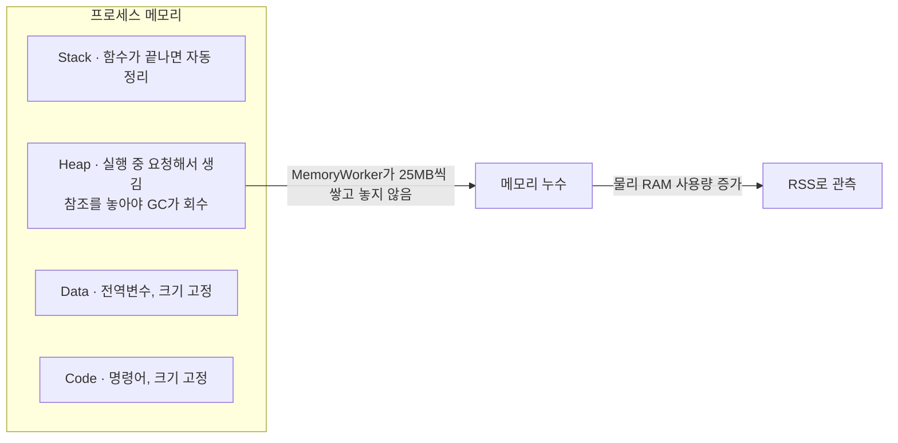
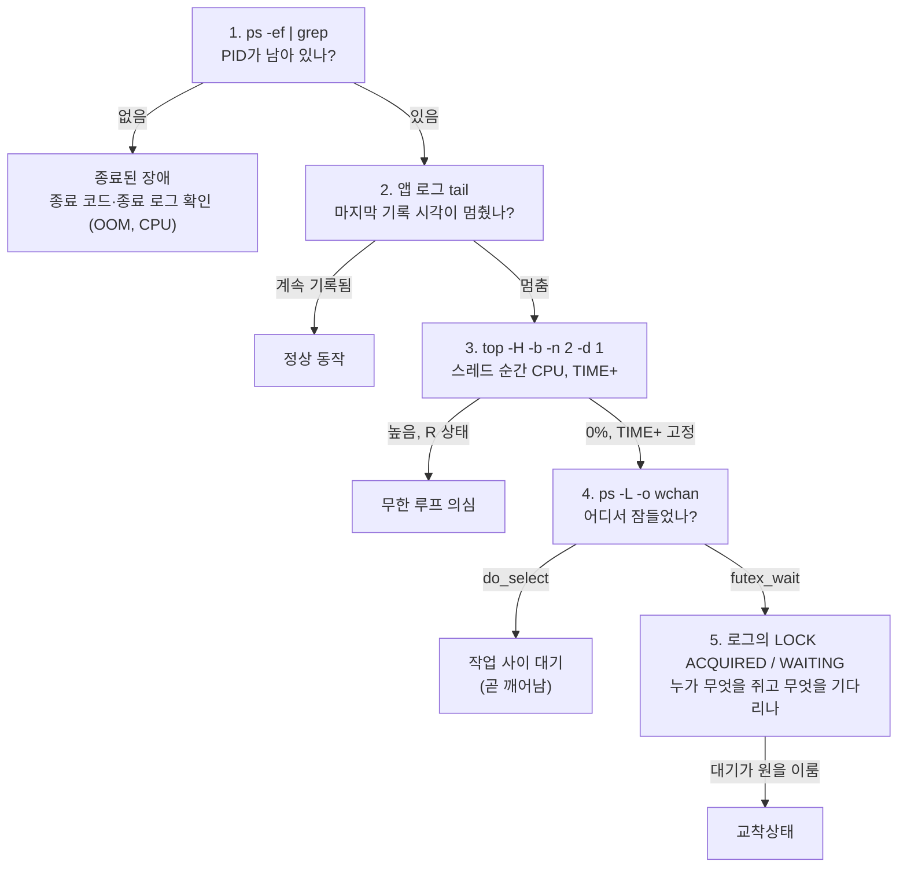
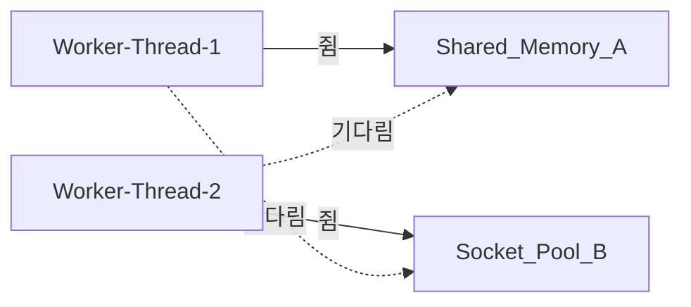

# B4-2 시스템 장애 분석 및 트러블슈팅

## 개요

이 미션에서는 Linux 환경에서 실행되는 `agent-leak-app`에서 `메모리 부족`, `CPU 과점유`, `교착상태`가 발생했을 때 원인을 찾는 방법을 학습한다. 프로그램이 종료되거나 멈췄다는 결과만 보는 것이 아니라, `05-monitor-app-resources.sh`, 프로그램 로그, Linux 명령어의 출력 결과를 증거로 사용한다.

각 장애를 재현한 뒤 관련 환경변수를 변경하여 다시 실행한다. 변경 전과 변경 후의 결과를 비교하고, 분석 내용을 `GitHub Issue` 형식의 기술 리포트 3건으로 작성한다.

<br>

### 학습 목표

- 메모리 구조를 이해하고, 메모리 누수가 시스템 전체에 미치는 영향을 설명할 수 있다.
- 특정 프로세스의 CPU 과점유가 시스템 지연을 유발하는 원리를 설명할 수 있다.
- 자원 경쟁으로 인해 발생하는 교착상태(Deadlock)의 개념을 이해하고, 프로세스가 멈춘 상태를 시스템 도구로 식별하여 진단할 수 있다.
- 로그와 관제 데이터를 증거로 제시하여 육하원칙에 맞게 장애 상황을 기술하고, GitHub Issue를 통해 동료 개발자와 명확하게 소통할 수 있다.

<br>

### 장애 분석 흐름

```text
1. 앱 실행
2. 자원 모니터링 (ps, top 등)
3. 장애 관측 (현상 관측 및 로그 수집)
4. 환경변수 변경
5. 환경변수 변경 전/후 결과 비교
```

| 단계 | 이 레포에서 하는 일 |
|---|---|
| 1. 앱 실행 | 일반 사용자 `agentuser`로, 장애 하나만 WARNING이 되도록 환경변수를 고정해 실행 |
| 2. 자원 모니터링 | `05-monitor-app-resources.sh`가 1초마다 관제 로그, `07-capture-system-tools.sh`가 3초마다 `ps -ef`, `ps -L`, `top -H` 출력을 저장 |
| 3. 장애 관측 | 앱 로그, 종료 코드, 관제 로그, 명령어 출력을 `evidence/<장애>/`에 저장하고 원인을 추론 |
| 4. 환경변수 변경 | 장애와 관련된 환경변수 **하나만** 변경. 여러 값을 함께 바꾸면 어떤 설정이 결과에 영향을 주었는지 알 수 없다 |
| 5. 전후 비교 | 생존 시간, 자원 사용량, 종료 여부를 비교하고 리포트로 작성 |

<br>
<br>

## 빠른 실행

레포 루트에서 실행한다. 컨테이너 준비부터 6개 케이스 실험, 증거 저장까지 한 번에 진행된다.

```bash
# 전체: 셋업 + 6개 실험 (약 8분)
bash scripts/00-run-all-experiments.sh

# 특정 케이스만
bash scripts/00-run-all-experiments.sh cpu-before cpu-after

# 셋업 없이 특정 케이스만 (컨테이너가 이미 준비된 경우)
SKIP_SETUP=1 bash scripts/00-run-all-experiments.sh deadlock-before
```

| 케이스마다 저장되는 증거 (`evidence/<장애>/<before\|after>-*`) | 내용 |
|---|---|
| `app.log` | 앱 콘솔 출력 (부팅 검사, Worker 로그, 종료 배너) |
| `monitor.log`, `timeseries.csv` | 05 관제 로그 원본과 시계열 CSV |
| `systools.log` | 07이 저장한 `ps -ef`, `ps -L`(`wchan` 포함), `top -H` 출력 |
| `run.log` | 실행 스크립트 기록 (종료 방식, 종료 코드) |
| `env-snapshot.txt`, `report-snippet.md` | 실험 시점 환경변수, 리포트 인용용 요약 |

단계별 개별 실행, 케이스별 설정값, 관제 로그 형식은 [03-scripts.md](./docs/03-scripts.md)에 정리했다.

<br>
<br>

## 과제 앱의 구성과 장애 시나리오

과제에서 주어진 `agent-leak-app-x86`은 Python으로 만든 앱을 PyInstaller로 하나의 실행 파일로 묶은 것이다. 앱 하나 안에 장애를 일부러 일으키는 작업 3가지와, 장애를 감지해 앱을 멈추는 보호 장치 2가지가 들어 있다.

| 구성 요소 | 하는 일 | 관련 환경변수 |
|---|---|---|
| `MemoryWorker` | 3초마다 Heap에 25MB를 할당하고 해제하지 않는다 (메모리 누수) | `MEMORY_LIMIT` |
| `MemoryGuard` | Heap이 `MEMORY_LIMIT`에 닿으면 앱을 스스로 종료한다 (SIGKILL) | `MEMORY_LIMIT` |
| `CpuWorker` | 3초마다 부하(`Current Load`)를 올린다 (CPU 과점유) | `CPU_MAX_OCCUPY` |
| `Watchdog` | 부하가 기준을 넘으면 앱에 종료 신호를 보낸다 (SIGTERM) | `CPU_MAX_OCCUPY` |
| `AgentWorker` + `Worker-Thread-1/2` | 스레드 2개가 Lock 2개를 서로 반대 순서로 잡는다 (교착상태) | `MULTI_THREAD_ENABLE` |

앱은 부팅할 때 환경변수 3개를 검사하고, 권장 범위를 벗어난 항목(`WARNING`)에 맞는 장애 시나리오 하나를 골라 실행한다. 모두 권장 범위면 장애 없이 정상 동작한다.


- 장애 3가지는 드러나는 모습이 서로 달라서 실험도 3번 따로 한다. 한 번에 환경변수 하나만 WARNING이 되도록 나머지 값을 고정해야 다른 장애가 먼저 끼어들지 않는다. 케이스별 값은 [experiment-cases.conf](./scripts/experiment-cases.conf)에 있다.
- `MEMORY_LIMIT`과 `MULTI_THREAD_ENABLE`이 동시에 WARNING이면 메모리 시나리오가 실행되었다 (OOM 실험에서 관측).
- 스레드 구성, 부모·자식 프로세스 구조는 [01-concepts.md](./docs/01-concepts.md#1-프로그램-프로세스-스레드)에 그림과 함께 정리했다.

<br>
<br>

## 장애별 관측 대상과 개념

장애마다 문제가 생기는 자원이 다르다. 그래서 먼저 "어떤 자원이 어떻게 생겼는지"를 알고, 그 자원을 보여 주는 값을 골라 관측해야 한다.

| 장애 | 앱이 어떻게 끝나나 | 문제가 생기는 자원 | 알아야 할 개념 | 그래서 보는 값 |
|---|---|---|---|---|
| OOM | 스스로 종료 (메모리 한도) | 프로세스 메모리 (그중 Heap) | 메모리 영역 구성, Heap 할당·해제, RSS와 VSZ | RSS 추세, 앱 로그의 Heap, `MemoryGuard` 로그 |
| CPU | 종료 신호로 종료 (부하 한도) | CPU 코어 시간 | 코어, `%CPU`의 기준, 누적 평균과 순간값 | `top` 순간 `%CPU`, `TIME+`, 앱 로그의 Load, `WATCHDOG` 로그 |
| Deadlock | 종료되지 않고 멈춤 | 스레드와 Lock | 스레드 상태, Lock 대기, 커널 대기 지점 | PID 유지, 스레드별 `wchan`, `TIME+` 정체, 마지막 로그 |

<br>

### OOM: 프로세스 메모리 중 Heap을 본다

프로세스 메모리는 Code, Data, Heap, Stack 4개 영역으로 나뉜다.



- 실행 중에 계속 늘어날 수 있는 영역은 Heap뿐이다. Code와 Data는 크기가 고정이고, Stack은 함수가 끝나면 자동으로 정리된다. 그래서 누수는 Heap에서 생긴다.
- OS 밖에서는 Heap만 따로 볼 수 없다. 대신 모든 영역 중 실제 RAM에 올라간 크기인 **RSS**를 본다. VSZ는 예약만 하고 안 쓴 공간까지 포함하므로 누수 판단에 쓰지 않는다.
- 앱 로그의 `Current Heap`과 RSS를 시각으로 맞춰 보면 "Heap이 늘어서 RSS가 늘었다"는 연결고리가 생긴다.

#### RSS를 기록하고 꺼내는 방법

| 단계 | 사용한 명령 | 하는 일 |
|---|---|---|
| 대상 찾기 | `ps aux \| grep agent-leak-app-x86 \| sort -k6 -nr` | 같은 이름의 프로세스(부트로더, 실제 앱) 중 6번째 열 RSS가 가장 큰 것을 실제 앱으로 고른다 |
| 값 읽기 | `ps -p <PID> -o ppid=,stat=,etime=,%cpu=,%mem=,rss=,args=` | 칸 이름 없이(`=`) 한 줄로 받아 RSS(KB), 상태, 경과 시간 등을 변수에 나눠 담는다 |
| 시스템 비교값 | `free` → 사용량 / 전체 × 100 | 같은 줄에 `SYS_MEM`을 남겨 프로세스 문제인지 시스템 전체 문제인지 비교한다 |
| 기록 | `printf ... >> monitor.log` | `[시각] PID:… RSS:…KB` 형식으로 한 줄씩 추가한다. 10MB를 넘으면 파일을 돌려서 보관한다 |
| 꺼내기 | `06-summarize-evidence.sh`의 `gawk match($0, /RSS:([0-9]+)KB/)` | 줄마다 정규식으로 값만 뽑아 시각별 CSV로 만든다 |
| 판단 | CSV의 RSS 차이 + 앱 로그 시각 | 약 3초마다 +25,604KB, 감소 없음. 증가 시점이 `Current Heap` 로그 직후와 일치 |

#### MemoryGuard가 스스로 종료하는 이유

- 누수는 저절로 멈추지 않는다. 그대로 두면 RSS가 물리 RAM을 다 채우고, 그 전에 스왑이 시작되면서 시스템 전체가 느려진다.
- RAM이 바닥나면 커널 OOM Killer가 점수(badness)를 매겨 종료할 프로세스를 고른다. 이때 누수를 일으킨 앱이 아니라 DB나 SSH 같은 다른 중요한 프로세스가 선택될 수도 있다.
- MemoryGuard는 그 상황이 오기 전에 한도에서 **자기 자신만** 내린다. 피해 범위를 한 프로세스로 묶고, `Memory limit exceeded` 로그로 원인을 남겨 둔다.
- 자세한 설명: [01-concepts.md 4장](./docs/01-concepts.md#4-메모리-누수), [5장 RSS](./docs/01-concepts.md#5-rss), [05-study.md OOM Killer](./docs/05-study.md#리눅스-os-커널의-oom-killer)

<br>

### CPU: 코어 하나 기준의 순간 사용률을 본다

CPU 안에는 명령을 따로 처리하는 계산기(코어)가 여러 개 있다. 실험 컨테이너는 8코어이다.

- `top`과 `ps`의 `%CPU`는 **코어 1개 기준**이다. 코어 하나를 꽉 쓰면 100%, 8코어 전부면 800%까지 나온다.
- 스레드 하나는 한순간에 코어 하나에서만 돈다. 그래서 스레드별 `%CPU`(`top -H`)를 봐야 누가 코어를 잡고 있는지 알 수 있다. 시스템 전체 `SYS_CPU`만으로는 알 수 없다.
- `ps`의 `%CPU`는 "시작부터 지금까지의 평균"이라, CPU를 안 써도 시간이 지나면 값이 줄어든다. 급상승은 `top`의 순간값(직전 1초)과 `TIME+`(누적 CPU 시간)가 늘어나는 속도로 본다.
- 진짜 과점유라면 어떤 스레드가 `%CPU` 100% 근처, 상태 `R`(실행 중)이고, `TIME+`가 1초에 1초씩 늘어난다.

#### CPU를 볼 때 쓴 도구와 옵션

| 명령 | 옵션의 의미 | 보여 주는 값 | 쓰인 곳 |
|---|---|---|---|
| `ps -p <PID> -o %cpu` | `-p`: 대상 PID만, `-o`: 출력할 칸 지정 | 시작부터 지금까지의 평균 사용률 | 05 관제 `PROC_CPU` |
| `top -bn1` | `-b`: 화면 대신 텍스트로 출력(파일 저장용), `-n1`: 1회만 | `Cpu(s)` 줄의 유휴(`id`) → 100 - 유휴 | 05 관제 `SYS_CPU` |
| `top -H -b -n 2 -d 1 -p <PID>` | `-H`: 스레드별로, `-n 2 -d 1`: 1초 간격 2회 측정, `-p`: 대상 PID만 | 2회차의 스레드별 순간 `%CPU`, 누적 `TIME+` | 07 스냅샷 |
| `ps -L -p <PID> -o tid,stat,%cpu,wchan` | `-L`: 스레드마다 한 줄 | 스레드 상태, 평균 `%CPU`, 커널 대기 함수 | 07 스냅샷 |

- `top`의 1회차 값은 비교할 이전 측정이 없어서 순간값으로 쓰지 않는다. 2회 측정해서 두 번째 값만 남기는 이유다.
- `ps`는 평균, `top` 2회차는 순간값이다. 그래서 "급하게 올랐는가"는 `top`으로, "지금까지 얼마나 썼는가"는 `TIME+`로 본다.

#### Watchdog이 프로세스 하나를 종료하는 이유

- CPU 시간은 스케줄러가 여러 프로세스에 나눠 주는 공유 자원이다. 한 프로세스가 코어를 계속 쥐고 있으면 실행 대기열(Run Queue)에 줄 선 다른 프로세스의 차례가 늦어져, 서버 전체의 응답이 느려진다.
- `nice`로 우선순위를 낮춰도 실행할 일이 남은 프로세스는 계속 몫을 가져간다. `nice`는 나눠 갖는 비율을 바꿀 뿐 실행을 막지는 않는다.
- 문제 프로세스 하나를 내리면 그 코어 시간이 바로 다른 프로세스에게 돌아간다. 서버 전체가 느려지는 것보다 한 프로세스가 재시작하는 쪽이 피해가 작다.
- Watchdog은 `SIGTERM`을 써서 정리 작업을 할 기회를 준다. MemoryGuard가 `SIGKILL`로 즉시 끝내는 것과 다르다.
- 자세한 설명: [01-concepts.md 7장](./docs/01-concepts.md#7-cpu와-cpu-과점유)

<br>

### Deadlock: 스레드가 어디서 잠들어 있는지 본다

스레드는 일이 없거나 무언가를 기다릴 때 커널 안에서 잠든다(상태 `S`). 어느 함수에서 잠들었는지는 `wchan` 값으로 보인다.

| `wchan` | 뜻 | 해석 |
|---|---|---|
| `do_select` | 시간이 지나기를 기다리며 잠듦 (`sleep`) | 작업 사이에 쉬는 중, 곧 다시 일함 |
| `futex_wait` | Lock이 풀리기를 기다리며 잠듦 | 다른 스레드가 Lock을 놓아야 깨어남 |
| `do_wait` | 자식 프로세스가 끝나기를 기다림 | 부트로더가 실제 앱을 기다리는 상태 |

- Deadlock이면 프로세스는 살아 있고(PID 유지), 스레드들은 `futex_wait`에서 잠든 채 CPU를 전혀 쓰지 않는다(`TIME+` 고정). 그래서 CPU·메모리 지표만 보면 "조용하고 멀쩡한" 프로세스처럼 보인다.
- 그래서 PID 유지, 로그 정지, 스레드 대기 지점, Lock 획득 순서를 함께 봐야 단순히 쉬는 것과 교착상태를 구분할 수 있다.

#### 교착상태가 생기는 원리

교착상태는 아래 네 조건이 동시에 성립할 때 생긴다. 이 앱에서는 특히 상호 배제와 순환 대기가 로그에 그대로 드러난다.

| 조건 | 뜻 | 이 앱에서 |
|---|---|---|
| 상호 배제 | 자원 하나는 한 번에 한 스레드만 쓸 수 있다 | `Strict resource locking is enabled` → `Shared_Memory_A`, `Socket_Pool_B`는 Lock을 쥔 스레드만 사용 |
| 점유 대기 | 자원을 쥔 채로 다른 자원을 기다린다 | `LOCK ACQUIRED ... (Holding...)` 뒤에 `Need resource ...` |
| 비선점 | 남이 쥔 자원을 강제로 빼앗을 수 없다 | `WAITING ... (Status: BLOCKED)`가 끝나지 않음 |
| 순환 대기 | 기다림의 화살표가 원을 그린다 | Thread-1 → B(Thread-2가 쥠) → Thread-2 → A(Thread-1이 쥠) → Thread-1 |

- 상호 배제만 있으면 순서대로 기다리면 끝난다. 그런데 두 스레드가 Lock을 **서로 반대 순서**(A→B, B→A)로 잡으면 대기가 원을 이루고, 어느 쪽도 먼저 놓지 않으니 영원히 끝나지 않는다.
- 네 조건 중 하나만 깨도 교착상태는 생기지 않는다. 가장 쉬운 방법은 모든 스레드가 같은 순서로 Lock을 잡게 해서 순환 대기를 없애는 것이다.

#### 멈춘 프로세스를 진단한 순서



- 1~2단계로 "살아 있지만 일을 안 한다"를 확인하고, 3단계로 "바빠서 멈춘 것(무한 루프)"과 "기다리느라 멈춘 것"을 가른다.
- 4단계에서 기다리는 대상이 Lock(`futex_wait`)인지 확인하고, 5단계에서 로그로 순환을 증명한다.
- 자세한 설명: [01-concepts.md 10장](./docs/01-concepts.md#10-deadlock), [04-analysis.md](./docs/04-analysis.md)

<br>
<br>

## 결과 비교

2026-10-28 `bash scripts/00-run-all-experiments.sh` 실행 결과이다. 장애마다 환경변수 하나만 바꿔 같은 조건으로 두 번 실행했다.

| 장애 | 변경 환경변수 | Before | After | 리포트 |
|---|---|---|---|---|
| OOM | `MEMORY_LIMIT` 100 → 256 | 약 11초 생존, Heap 100MB에서 `SELF-TERMINATED`, 종료 코드 137 (SIGKILL) | 약 32초 생존, Heap 275MB에서 같은 방식 종료. 증가 속도(25MB/3초)는 동일 | [01](./reports/01-oom-report.md) |
| CPU | `CPU_MAX_OCCUPY` 90 → 50 | 앱 보고 Load 51.54%에서 `WATCHDOG ... (SIGTERM)`, 약 24초 만에 종료 코드 143 | 50%에서 cooldown 반복, 120초 관찰 동안 종료 없음 | [02](./reports/02-cpu-report.md) |
| Deadlock | `MULTI_THREAD_ENABLE` true → false | 약 9초 후 두 스레드 `BLOCKED`, 이후 PID만 남은 채 120초 무응답 | Lock 경합 없이 120초 동안 로그 계속 진행 | [03](./reports/03-deadlock-report.md) |

- 세 장애 모두 환경변수 변경으로 증상은 사라지거나 늦춰졌지만, 메모리 누수·부하 상승·Lock 순서 문제는 코드에 그대로 남아 있다. 근본 해결 제안은 각 리포트 4장에 정리했다.
- After의 CPU, Deadlock은 장애 없이 계속 동작하므로 `RUN_TIMEOUT`(120초)으로 실험을 끝냈다. 이때의 종료 코드 143은 스크립트가 보낸 SIGTERM이다.
- 종료 배너(`WATCHDOG`, `SELF-TERMINATED`)가 처음에는 로그에 남지 않았던 문제와 해결 과정은 [06-troubleshooting.md](./docs/06-troubleshooting.md)에 정리했다.

<br>
<br>

## 장애별 검증

각 표의 "확인 방법"은 `evidence/`에 저장된 증거를 직접 확인하는 명령이다. 표 아래의 "출력 읽는 법"은 실제 출력에서 어떤 값을 보고 무엇을 판단했는지 정리한 것이다.

<br>

### OOM 메모리 누수: MemoryGuard 자가 종료 확인

- MemoryWorker가 Heap을 반납하지 않는 누수 때문에 RSS가 3초마다 25MB씩 늘었고, Heap이 MEMORY_LIMIT에 닿자 MemoryGuard가 SIGKILL로 스스로 종료했다.
- 한도를 100에서 256으로 올리니 생존 시간만 11초에서 32초로 늘고 같은 방식으로 종료됐다.

| 과제 요구 증거 | 확인 방법 | 실제 결과 | 판정 |
|---|---|---|---|
| 관제 데이터의 메모리 상승 수치 | `05-monitor`가 1초마다 `ps -p <PID> -o rss` 기록 → `cat evidence/oom/before-timeseries.csv` | RSS 25,592KB → 51,196 → 76,800 → 102,404KB (3초마다 +25MB) | ✅ |
| `Memory limit exceeded` / `SELF-TERMINATED` 로그 | `grep -E "Memory limit\|SELF-TERMINATED" evidence/oom/before-app.log` | `Memory limit exceeded (100MB >= 100MB)`, `>>> [SYSTEM] SELF-TERMINATED (Memory Limit Exceeded) <<<` | ✅ |
| 종료 방식 | `grep "Exit code" evidence/oom/before-run.log` | `137 (SIGKILL)`, MemoryGuard가 스스로 종료 | ✅ |
| `MEMORY_LIMIT` 변경 전후 2회 이상 실행 비교 | `oom-before`(100), `oom-after`(256) 실행 | 생존 약 11초 → 약 32초, 증가 속도는 동일 | ✅ |

#### 출력 읽는 법 (OOM)

```text
# 05 관제 로그 (evidence/oom/before-monitor.log)
[2026-10-28 16:17:00] PID:1110 PPID:1095 STATE:SN+ ... THREADS:1 PROC_CPU:17.3% PROC_MEM:0.3% RSS:25592KB  ... SYS_MEM:13.4%
[2026-10-28 16:17:08] PID:1110 PPID:1095 STATE:SN+ ... THREADS:1 PROC_CPU:2.8%  PROC_MEM:1.2% RSS:102404KB ... SYS_MEM:14.6%

# 07 ps -L (evidence/oom/before-systools.log)
    PID     TID STAT %CPU %MEM   RSS     ELAPSED WCHAN                COMMAND
   1110    1110 SN+   2.5  1.2 102404      00:10 do_select            agent-leak-app-
```

| 값 | 뜻 | 이번 값 | 해석 |
|---|---|---|---|
| `RSS` | 프로세스가 실제 RAM에 올린 크기 (KB) | 25,592 → 102,404 | 3초마다 약 25MB씩 증가하고 줄지 않음 → 누수 |
| 앱 로그 `Current Heap` | 앱이 Heap에 쌓은 양 | 25 → 100MB | RSS 증가 시점과 일치 → RSS 증가의 원인이 Heap |
| `PROC_MEM` / `SYS_MEM` | 전체 RAM 중 이 프로세스 / 시스템 전체 비율 | 0.3 → 1.2% / 13~14% | 시스템 전체가 부족해지기 전에 앱이 먼저 종료 |
| `PROC_CPU`, `%CPU` | CPU 사용률 | 시작 직후 17%, 이후 2~3% | 부팅 작업 뒤로는 거의 안 씀 → CPU 문제 아님 |
| `THREADS`, `TID` | 스레드 수 | 1 | 스레드 경쟁(Deadlock)과 무관 |
| 종료 코드 | 128 + 시그널 번호 | 137 = 128 + 9 (SIGKILL) | MemoryGuard가 스스로 강제 종료 |

<br>

### CPU 과점유: Watchdog SIGTERM 종료 확인

앱 내부의 Watchdog이 앱이 계산한 부하(`Current Load`)가 임계치를 넘는 순간 SIGTERM으로 앱을 종료시키는 현상

| 과제 요구 증거 | 확인 방법 | 실제 결과 | 판정 |
|---|---|---|---|
| CPU 급상승 구간 (`top`/`ps`/관제) | 앱 로그 `grep "Current Load" evidence/cpu/before-app.log`, 관제 `PROC_CPU`, 같은 실행의 `top -H`/`ps -L` 출력 `evidence/cpu/before-systools.log` | 앱 보고 Load가 약 22초 동안 5% → 51.54%로 상승. 같은 구간 `top` 순간 CPU 0~3.9%, `ps` 누적 평균 19.3% → 1.8%. 상승은 앱 내부 Load에서만 관측됨을 OS 도구 출력으로 함께 제시 | ✅ |
| `WATCHDOG ... SIGTERM` 종료 로그 | `grep -E "Threshold\|WATCHDOG" evidence/cpu/before-app.log` | `CPU Threshold Violated! (51.54%)`, `>>> [SYSTEM] WATCHDOG: INITIATING EMERGENCY ABORT (SIGTERM) <<<` | ✅ |
| 종료 방식 | `grep "Exit code" evidence/cpu/before-run.log` | `143 (SIGTERM)`, 타임아웃(120초) 전에 종료 | ✅ |
| `CPU_MAX_OCCUPY` 변경 전후 비교 | `cpu-before`(90), `cpu-after`(50) 실행 | 약 24초 만에 종료 → 50%에서 cooldown 반복, 120초 동안 종료 없음 | ✅ |

#### 출력 읽는 법 (CPU)

```text
# 앱 로그 (evidence/cpu/before-app.log)
2026-10-28 16:18:02,766 [INFO] [CpuWorker] Current Load: 26.24%

# 07 ps -L / top -H, 같은 실행 16:18:05 (evidence/cpu/before-systools.log)
    PID     TID STAT %CPU %MEM   RSS     ELAPSED WCHAN                COMMAND
   2320    2320 SN+   2.2  0.3 25768       00:14 do_select            agent-leak-app-
    PID USER      PR  NI    VIRT    RES    SHR S  %CPU  %MEM     TIME+ COMMAND
   2320 agentus+  30  10  443208  25768  10168 S   3.9   0.3   0:00.36 agent-l+
```

| 값 | 뜻 | 이번 값 | 해석 |
|---|---|---|---|
| 앱 로그 `Current Load` | 앱이 스스로 계산해 보고하는 부하 | 5 → 51.54% | Watchdog이 판단하는 기준값, 50% 넘자 종료 |
| `top` `%CPU` | 직전 1초 동안 코어 1개 기준 순간 사용률 | 0 ~ 3.9% | 실제 CPU는 거의 안 씀 |
| `TIME+` | 시작부터 쓴 CPU 시간 누적 | 22초 동안 0.15초 증가 | 과점유라면 22초 가까이 늘어야 함 |
| `ps` `%CPU` | 시작부터의 평균 사용률 | 19.3 → 1.8% | 시작 직후 부팅 작업 때문에 높고 이후 계속 희석 |
| `S` / `STAT` | 프로세스 상태 | `S` (대기) | 실행 중(`R`)이 아님 |
| `NI` | nice 값 (클수록 CPU를 양보) | 10 | SafetyGuard가 우선순위를 낮춤 |
| 종료 코드 | 128 + 시그널 번호 | 143 = 128 + 15 (SIGTERM) | 타임아웃 전 종료 → Watchdog이 보낸 SIGTERM |

- 앱의 Load는 OS가 재는 실제 CPU 사용률과 다른 앱 내부 계산값으로 판단했다. 그래서 CPU 장애 판단의 근거는 앱 로그의 Load 추이, `WATCHDOG` 배너, 종료 코드이고, OS 도구 출력은 실제 사용률이 낮았다는 사실을 함께 보여 준다. 분석은 [02-cpu-report.md](./reports/02-cpu-report.md) 3장에 있다.

<br>

### Deadlock(교착 상태): 순환 대기로 인한 무응답 확인

4가지 조건이 맞물려 스레드들이 서로 자원을 무한히 기다리며 멈추는 무응답 현상

| 과제 요구 증거 | 확인 방법 | 실제 결과 | 판정 |
|---|---|---|---|
| PID가 계속 존재 (`ps -ef \| grep`) | `07-capture`가 3초마다 `ps -ef \| grep agent-leak-app-x86` 기록 → `grep -A4 "sample 27" evidence/deadlock/before-systools.log` | 27회 모두 `script`(5713) → 부트로더(5717) → 실제 앱(5734) 유지, `App still running after 120s` | ✅ |
| CPU·메모리 정체 (`top -H`/`ps -L`) | `evidence/deadlock/before-systools.log`의 `top -H -b -n 2 -d 1 -p <PID>`, `ps -L -p <PID>` 출력 + 관제 `RSS` | 스레드 3개 모두 순간 CPU 0.0%, `TIME+`가 약 100초 동안 0:00.23에서 고정, RSS 증가 없음 | ✅ |
| 마지막 `WAITING ... BLOCKED` 로그 | `tail -n 2 evidence/deadlock/before-app.log` | 두 스레드가 서로의 Lock을 `WAITING ... (Status: BLOCKED)`, 이후 약 110초 로그 없음 | ✅ |
| 스레드·Lock 대기 추론 | Lock 획득 로그 순서 + `ps -L -o ...,wchan` 출력 | BLOCKED 직전 `do_select` → 이후 3개 스레드 모두 `futex_wait`(Lock 대기), Lock을 서로 반대 순서로 획득 → 순환 대기 | ✅ |
| `MULTI_THREAD_ENABLE` 변경 전후 비교 | `deadlock-before`(true), `deadlock-after`(false) 실행 | 9초 후 무응답 → 120초 동안 로그 계속 진행 | ✅ |

#### 출력 읽는 법 (Deadlock)

```text
# 07 ps -ef / ps -L / top -H, BLOCKED 107초 후 16:22:20 (evidence/deadlock/before-systools.log)
agentus+    5713    5699  0 16:20 ?        00:00:00 /usr/bin/script script -qefc exec /workspace/bin/agent-leak-app-x86 /dev/null
agentus+    5717    5713  0 16:20 pts/0    00:00:00 /workspace/bin/agent-leak-app-x86 /workspace/bin/agent-leak-app-x86
agentus+    5734    5717  0 16:20 pts/0    00:00:00 /workspace/bin/agent-leak-app-x86 /workspace/bin/agent-leak-app-x86

    PID     TID STAT %CPU %MEM   RSS     ELAPSED WCHAN                COMMAND
   5734    5734 SNl+  0.1  0.2 18500       01:56 futex_wait           agent-leak-app-
   5734    5899 SNl+  0.0  0.2 18500       01:49 futex_wait           agent-leak-app-
   5734    5900 SNl+  0.0  0.2 18500       01:49 futex_wait           agent-leak-app-

    PID USER      PR  NI    VIRT    RES    SHR S  %CPU  %MEM     TIME+ COMMAND
   5734 agentus+  30  10  589536  18500   3088 S   0.0   0.2   0:00.23 agent-l+
   5899 agentus+  30  10  589536  18500   3088 S   0.0   0.2   0:00.00 agent-l+
   5900 agentus+  30  10  589536  18500   3088 S   0.0   0.2   0:00.00 agent-l+
```

| 값 | 뜻 | 이번 값 | 해석 |
|---|---|---|---|
| `ps -ef`의 PID / PPID | 프로세스 번호와 부모 번호 | `script`(5713) → 부트로더(5717) → 앱(5734) | 120초 내내 같은 PID → 종료되지 않음 |
| `TID` | 스레드 번호 (`top -H`에서는 PID 칸에 표시) | 5734(메인), 5899, 5900 | 메인 + Worker 2개 |
| `STAT` `SNl+` | S 대기, N 낮은 우선순위, l 멀티스레드, + 포그라운드 | 3개 모두 `S` | 아무도 실행 중이 아님 |
| `WCHAN` | 스레드가 커널 안에서 잠든 함수 | 3개 모두 `futex_wait` | 쉬는 게 아니라 Lock을 기다리는 중 (BLOCKED 직전은 `do_select`) |
| `top` `%CPU` | 직전 1초 순간 사용률 | 3개 모두 0.0% | CPU를 전혀 안 씀 |
| `TIME+` | 누적 CPU 시간 | 16:20:38 ~ 16:22:20 동안 `0:00.23` 고정 | 약 100초 동안 한 번도 실행되지 않음 → 정체 |
| `ps -L` `%CPU` | 시작부터의 평균 | 1.5 → 0.1% | 줄어드는 건 평균이 희석된 것일 뿐, 정체 근거는 `TIME+` |
| `RSS` | 실제 RAM 사용량 | 증가 없이 18,500KB 고정 | 새 작업을 하지 않음 |

- After(`MULTI_THREAD_ENABLE=false`)에서도 스레드는 3개지만 Worker 2개의 `WCHAN`은 `do_select`이고 `TIME+`가 계속 늘어난다. `futex_wait`는 Worker를 기다리는 메인 스레드뿐이다.

#### 로그에서 순환 대기를 찾은 과정

`grep -E "LOCK ACQUIRED|WAITING" evidence/deadlock/before-app.log`로 Lock 관련 줄만 남기고, 줄마다 "누가 무엇을 쥐었나 / 기다리나"를 적었다.

| 시각 | 로그 | 관계 |
|---|---|---|
| 16:20:31.493 | `[Worker-Thread-1] LOCK ACQUIRED: [Shared_Memory_A]` | A는 Thread-1이 쥠 |
| 16:20:31.493 | `[Worker-Thread-2] LOCK ACQUIRED: [Socket_Pool_B]` | B는 Thread-2가 쥠 |
| 16:20:33.509 | `[Worker-Thread-1] WAITING for [Socket_Pool_B]... (Status: BLOCKED)` | Thread-1은 B를 기다림 |
| 16:20:33.509 | `[Worker-Thread-2] WAITING for [Shared_Memory_A]... (Status: BLOCKED)` | Thread-2는 A를 기다림 |



- 화살표를 이어 보면 Thread-1 → B → Thread-2 → A → Thread-1로 원이 닫힌다. 둘 다 상대가 놓기를 기다리므로 어느 쪽도 진행할 수 없다.
- 이 추론이 로그 문구만의 해석이 아니라는 근거는 OS 쪽에 있다. 이후 로그가 110초 동안 없고, 3개 스레드가 모두 `futex_wait`(Lock 대기)에서 잠들어 있으며, `TIME+`가 늘지 않았다.
- 판정 근거와 OS 동작 원리는 각 리포트([OOM](./reports/01-oom-report.md), [CPU](./reports/02-cpu-report.md), [Deadlock](./reports/03-deadlock-report.md))와 [04-analysis.md](./docs/04-analysis.md)에 정리했다.

<br>
<br>

## 운영 관점에서 다시 보기

실험 앱이 아니라 실제 서비스였다면 무엇을 바꾸고 어떤 순서로 대응할지 정리했다.

<br>

### 누수를 장애 전에 알아채려면: 관제 스크립트 개선

이번 관제는 값을 기록만 하고, 앱이 이미 종료된 뒤에 로그를 보고 누수를 알았다. 운영에서는 종료되기 전에 경고가 나와야 한다.

| 지금 | 바꿀 점 | 이유 |
|---|---|---|
| RSS를 그대로 기록 | 최근 N분 동안의 RSS 증가량(기울기)을 계산해, 계속 증가만 하면 경고 | 누수는 값의 크기보다 "줄지 않고 계속 오르는 모양"으로 먼저 드러난다 |
| 고정 기준 100MB로 경고 | `MEMORY_LIMIT` 대비 70%, 85%에서 단계별 경고, 현재 기울기로 한도 도달 예상 시각 표시 | 이번 데이터(3초에 25MB)라면 100MB 한도에 기동 후 약 11초 만에 닿는다는 걸 종료 전에 계산할 수 있다 |
| 1초 주기라고 했지만 실제 약 2초 | 수집 시간을 빼고 남은 시간만 쉬도록 보정 | 짧은 사건(마지막 할당 1ms 뒤 종료)을 놓쳤다 |
| `ps` 평균 `%CPU` | `top` 순간값 또는 `/proc/<PID>/stat`의 CPU 시간 차이 기록 | 평균값은 급상승을 가린다 |
| 로그 진행 여부를 보지 않음 | 앱 로그 마지막 기록 시각, `TIME+` 정체를 함께 감시 | 교착상태는 CPU·메모리 지표가 정상처럼 보인다 |
| 결과를 파일에만 남김 | 경고를 메신저나 알림 시스템으로 전송 | 사람이 로그를 열어 봐야만 아는 구조로는 사전 대응이 안 된다 |

<br>

### 셋 중 가장 위험하다고 본 장애: Deadlock

| 비교 | OOM | CPU | Deadlock |
|---|---|---|---|
| 앱이 스스로 끝나나 | 끝남 (MemoryGuard) | 끝남 (Watchdog) | **끝나지 않음** |
| 지표에 이상이 보이나 | RSS 증가 | 앱 Load 상승 | **CPU·메모리가 오히려 조용함** |
| 재시작으로 복구되나 | 서비스 관리자가 재시작 가능 | 재시작 가능 | 프로세스가 살아 있어 **재시작 조건에 안 걸림** |

- 다른 두 장애는 보호 장치가 앱을 내려서, 적어도 "죽었다"는 신호와 로그가 남는다. 교착상태는 PID가 살아 있고 자원 지표도 낮아서 일반적인 헬스 체크(프로세스 존재, CPU, 메모리)를 모두 통과한다. 그 사이 들어온 요청은 응답 없이 쌓인다.
- 예방
    - 코드: 모든 스레드가 Lock을 같은 순서로 잡도록 통일하고, `acquire(timeout=...)`로 일정 시간 안에 못 잡으면 쥔 Lock을 놓고 재시도한다.
    - 운영: 실제 요청을 처리해 봐야 통과하는 헬스 체크(liveness)를 두고, 응답이 없거나 로그 진행이 멈추면 재시작하도록 한다.

<br>

### OOM과 Deadlock이 한 서버에서 동시에 났다면

```text
1. 두 프로세스의 증거부터 남긴다     ps -ef, ps -L(wchan), top -H, 마지막 로그, 환경변수 (수 초)
2. OOM 쪽을 먼저 처리한다           메모리 한도 조정 또는 누수 프로세스 재시작
3. Deadlock 쪽을 분석하고 재시작한다  Lock 순서 확인 후 재시작
```

- **증거 먼저**: 어느 쪽이든 재시작하면 `wchan`, 스레드 상태, 메모리 상태가 사라진다. 수집은 몇 초면 끝나므로 가장 먼저 한다.
- **OOM 우선**: 누수는 시간이 갈수록 나빠지고, RAM이 바닥나면 커널 OOM Killer가 상관없는 프로세스까지 죽일 수 있다. 교착상태는 이미 멈춘 상태가 그대로 유지될 뿐 더 넓게 번지지 않는다.
- **같은 프로세스인지 확인**: 교착상태에 빠진 프로세스가 메모리를 쥐고 있어서 OOM이 난 것일 수도 있다. 1단계의 `ps` 출력으로 PID와 RSS를 보고 원인이 하나인지부터 확인한다.

<br>

### 소스 코드를 고칠 수 있다면

이번 조치는 환경변수로 증상만 피했다. 코드를 고칠 수 있다면 아래처럼 원인을 없앤다.

| 장애 | 원인 | 코드 개선 |
|---|---|---|
| OOM | 다 쓴 25MB 데이터를 리스트가 계속 참조 | 처리 끝난 데이터는 참조 제거(`pop`, `clear`), 크기 상한이 있는 캐시(`deque(maxlen=N)`, LRU) 사용 |
| CPU | 부하를 한도까지 계속 올림, 설정값(90)과 실제 기준(50)이 다름 | 작업을 잘게 나눠 중간에 CPU 양보, 설정값을 실제 판단 기준으로 사용 |
| Deadlock | 두 스레드가 Lock을 반대 순서로 획득 | Lock 획득 순서 통일, 타임아웃 있는 획득, Lock을 쥔 채 다른 자원을 요청하지 않도록 구간 분리 |

Lock 순서를 통일하는 예시이다 (실제 앱 코드가 아니라 로그 동작을 재현한 모델).

```python
import threading                           # 스레드와 Lock을 쓰기 위한 모듈

lock_a = threading.Lock()                  # Shared_Memory_A 를 지키는 Lock
lock_b = threading.Lock()                  # Socket_Pool_B 를 지키는 Lock

def worker_1():                            # Thread-1 작업
    with lock_a:                           # 항상 A 먼저
        with lock_b:                       # 그다음 B
            pass                           # A, B 를 함께 쓰는 작업

def worker_2():                            # Thread-2 작업 (원래는 B → A 순서였음)
    with lock_a:                           # Thread-1 과 같은 순서로 A 먼저
        with lock_b:                       # 그다음 B → 대기가 원을 이룰 수 없음
            pass                           # A, B 를 함께 쓰는 작업
```

<br>

### 처음부터 다시 한다면

| 이번에 겪은 일 | 처음부터 할 것 |
|---|---|
| `top` 순간값과 `wchan`을 처음엔 따로 측정해서, 본 실험 증거로 쓰기 어려웠다 | 실험 스크립트에 `ps -ef`, `ps -L`, `top -H` 수집을 처음부터 넣는다 (지금의 07 스크립트) |
| 종료 배너가 출력 버퍼링 때문에 로그에서 사라졌고, 종료 코드도 버려지고 있었다 | 앱 실행 방식(가상 터미널)과 종료 코드 기록부터 검증한 뒤 실험을 시작한다 |
| `ps`의 `%CPU`만 보고 CPU 상승을 찾으려 했다 | 도구가 무엇을 재는지(평균인지 순간값인지) 먼저 확인하고 도구를 고른다 |
| OOM 실험인데 THREAD도 WARNING이라 어떤 시나리오가 실행될지 헷갈렸다 | 실험마다 WARNING 항목이 하나만 되도록 나머지 값을 먼저 고정한다 |

<br>
<br>

## 요구사항 체크

| 요구사항 | 수행 내용 | 확인 위치 |
|---|---|---|
| 실행 조건 충족 | 일반 사용자(`agentuser`), 필수 환경변수, 디렉터리, `secret.key`, `AGENT_PORT=15034` 고정, `0.0.0.0:15034` 바인딩을 스크립트로 준비 | [02-environment.md](./docs/02-environment.md), [02-provision-runtime.sh](./scripts/02-provision-runtime.sh) |
| 장애 분석 리포트 3건 | OOM Crash, CPU Latency, Deadlock 리포트를 GitHub Issue로 작성 | [01-oom](./reports/01-oom-report.md), [02-cpu](./reports/02-cpu-report.md), [03-deadlock](./reports/03-deadlock-report.md) |
| 리포트 형식 | 세 리포트 모두 `[Bug]` 제목, Description(현상) / Evidence & Logs(증거) / Root Cause Analysis(원인) / Workaround & Verification(조치) 구조. 증거 발췌에는 PID, 로그 타임스탬프, 핵심 로그 메시지와 원본 파일 링크를 함께 넣음 | [reports/](./reports/) |
| 케이스별 필수 증거 | OOM, CPU, Deadlock 모두 충족 | [장애별 검증](#장애별-검증) |
| Before & After 증거 | 장애마다 환경변수 하나만 바꿔 2회 실행, 원본 로그 저장 | [결과 비교](#결과-비교), [evidence/](./evidence/) |
| 관련 OS 동작 원리 | PCB와 PID, 메모리 누수, RSS와 VSZ, Watchdog, SIGTERM/SIGKILL, Deadlock 4대 조건, Lock | [01-concepts.md](./docs/01-concepts.md) |
| 표준 명령어 사용 | `ps`, `top`, `kill`, 관제 스크립트만 사용. `ps -ef`/`ps -L`/`top -H` 출력은 실험마다 `evidence/<장애>/<phase>-systools.log`로 자동 저장. 바이너리 디컴파일 없음 | [04-analysis.md](./docs/04-analysis.md#증거-수집-명령어) |
| 재현성 | 스크립트 한 번으로 컨테이너 준비부터 6개 케이스 실험, 증거 저장까지 진행 | [빠른 실행](#빠른-실행), [03-scripts.md](./docs/03-scripts.md) |

<br>
<br>

## 상세 문서

| 문서 | 내용 |
|---|---|
| [01-concepts.md](./docs/01-concepts.md) | 프로세스와 스레드 구성, PID와 PCB, 부모·자식 프로세스, OOM, 메모리 누수, RSS와 VSZ, MemoryGuard, CPU 과점유, Watchdog, Deadlock, Lock |
| [02-environment.md](./docs/02-environment.md) | 실행 필수 조건, 환경변수 예시, 필수 디렉터리와 파일 생성 |
| [03-scripts.md](./docs/03-scripts.md) | Repository 구조, 스크립트별 역할, 실행 방법, 케이스별 설정값, 관제 로그 지표 |
| [04-analysis.md](./docs/04-analysis.md) | 장애 유형별 분석 절차, 증거 수집 명령어, 리포트 템플릿, 관측 사실과 추론 구분 |
| [05-study.md](./docs/05-study.md) | 일반 사용자 실행 이유, Heap과 Stack, OOM Killer, 누수 해결 방법, 운영 환경 완화책 |
| [06-troubleshooting.md](./docs/06-troubleshooting.md) | 종료 배너가 로그에 남지 않던 문제(출력 버퍼링, 종료 코드), 방화벽 상태 오기록 문제 |
| [07-peer-review.md](./docs/07-peer-review.md) | 동료평가 1:1 진행 대본, 요구사항 체크리스트, 꼬리 질문 |
