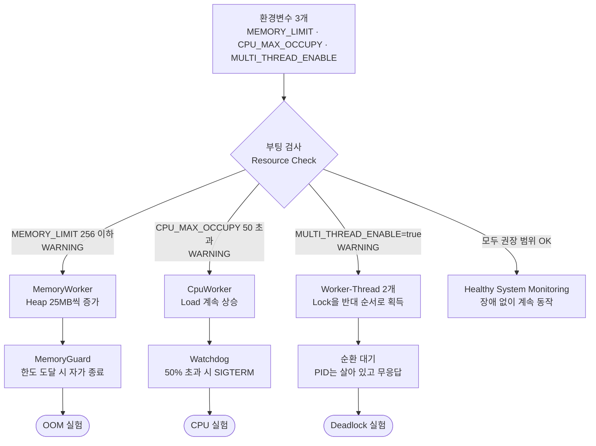

# B1-2 시스템 장애 분석 및 트러블슈팅

이 미션에서는 Linux 환경에서 실행되는 `agent-leak-app`에서 `메모리 부족`, `CPU 과점유`, `교착상태`가 발생했을 때 원인을 찾는 방법을 학습한다. 프로그램이 종료되거나 멈췄다는 결과만 보는 것이 아니라, `05-monitor-app-resources.sh`, 프로그램 로그, Linux 명령어의 출력 결과를 증거로 사용한다.

각 장애를 재현한 뒤 관련 환경변수를 변경하여 다시 실행한다. 변경 전과 변경 후의 결과를 비교하고, 분석 내용을 `GitHub Issue` 형식의 기술 리포트 3건으로 작성한다.

<br>
<br>

## 과제 앱의 구성과 장애 시나리오

과제에서 주어진 `agent-leak-app-x86`은 Python으로 만든 앱을 PyInstaller로 하나의 실행 파일로 묶은 것이다. 앱 하나 안에 장애를 일부러 일으키는 작업 3가지와, 장애를 감지해 앱을 멈추는 보호 장치 2가지가 들어 있다.

| 구성 요소 | 하는 일 | 관련 환경변수 |
|---|---|---|
| `MemoryWorker` | 3초마다 Heap에 25MB를 할당하고 해제하지 않는다 (메모리 누수) | `MEMORY_LIMIT` |
| `MemoryGuard` | Heap이 `MEMORY_LIMIT`에 닿으면 앱을 스스로 종료한다 (SIGKILL) | `MEMORY_LIMIT` |
| `CpuWorker` | 3초마다 부하(`Current Load`)를 올린다 (CPU 과점유) | `CPU_MAX_OCCUPY` |
| `Watchdog` | 부하가 기준을 넘으면 앱에 종료 신호를 보낸다 (SIGTERM) | `CPU_MAX_OCCUPY` |
| `AgentWorker` + `Worker-Thread-1/2` | 스레드 2개가 Lock 2개를 서로 반대 순서로 잡는다 (교착상태) | `MULTI_THREAD_ENABLE` |

앱은 부팅할 때 환경변수 3개를 검사하고, 권장 범위를 벗어난 항목(`WARNING`)에 맞는 장애 시나리오 하나를 골라 실행한다. 모두 권장 범위면 장애 없이 정상 동작한다.



장애의 종류가 3가지이고 드러나는 모습도 서로 다르다. 그래서 실험도 3번 따로 해야 한다.

| 장애 | 앱이 어떻게 끝나나 | 주로 보는 증거 |
|---|---|---|
| OOM | 스스로 종료 (메모리 한도) | RSS 증가 추세, `MemoryGuard` 로그 |
| CPU | 종료 신호로 종료 (부하 한도) | 부하 상승 구간, `WATCHDOG` 로그 |
| Deadlock | 종료되지 않고 멈춤 | PID 유지, 로그 정지, 스레드 대기 상태 |

- 한 번에 환경변수 하나만 WARNING이 되도록 나머지 값을 고정해야, 다른 장애가 먼저 끼어들지 않는다. 케이스별 값은 [experiment-cases.conf](./scripts/experiment-cases.conf)에 있다.
- `MEMORY_LIMIT`과 `MULTI_THREAD_ENABLE`이 동시에 WARNING이면 메모리 시나리오가 실행되었다 (OOM 실험에서 관측).
- 스레드 구성, 부모·자식 프로세스 구조는 [01-concepts.md](./docs/01-concepts.md#1-프로그램-프로세스-스레드)에 그림과 함께 정리했다.

<br>
<br>

## 결과 비교

2026-10-27 `bash scripts/00-run-all-experiments.sh` 실행 결과이다. 장애마다 환경변수 하나만 바꿔 같은 조건으로 두 번 실행했다.

| 장애 | 변경 환경변수 | Before | After | 리포트 |
|---|---|---|---|---|
| OOM | `MEMORY_LIMIT` 100 → 256 | 약 11초 생존, RSS 102,412KB에서 `Memory limit exceeded (100MB >= 100MB)` → `SELF-TERMINATED`, 종료 코드 137 (SIGKILL) | 약 32초 생존, RSS 281,636KB에서 `Memory limit exceeded (275MB >= 256MB)`로 같은 방식 종료. 증가 속도(25MB/3초)는 동일 | [01](./reports/01-oom-report.md) |
| CPU | `CPU_MAX_OCCUPY` 90 → 50 | 앱 보고 부하 5% → 55.10% 상승 후 `CPU Threshold Violated!` → `WATCHDOG ... (SIGTERM)`, 약 27초 만에 종료 코드 143 | 50%에서 cooldown 반복, 120초 관찰 동안 종료 없음 (타임아웃으로 중단) | [02](./reports/02-cpu-report.md) |
| Deadlock | `MULTI_THREAD_ENABLE` true → false | 9초 후 두 스레드 `WAITING ... BLOCKED`, 이후 로그 정지·CPU 0.1%·PID 유지 (120초 무응답) | Lock 경합 없이 로그 계속 진행, 120초 관찰 동안 정상 동작 (타임아웃으로 중단) | [03](./reports/03-deadlock-report.md) |

- 세 장애 모두 환경변수 변경으로 증상은 사라지거나 늦춰졌지만, 메모리 누수·부하 상승·Lock 순서 문제는 코드에 그대로 남아 있다. 근본 해결 제안은 각 리포트 4장에 정리했다.
- CPU 실험에서 OS 지표(`ps`/`top`)의 실제 CPU 사용률은 0~16%로 낮았다. 앱 로그의 `Current Load`는 앱 내부 계산값으로 보이며, CPU 장애 판단은 앱 로그와 종료 코드를 근거로 했다.
- `CPU_MAX_OCCUPY`를 80, 90 어느 쪽으로 설정해도 실제 종료는 부하가 50%를 넘는 순간 일어났다.
- 종료 배너(`WATCHDOG`, `SELF-TERMINATED`)가 처음에는 로그에 남지 않았던 문제와 해결 과정은 [06-troubleshooting.md](./docs/06-troubleshooting.md)에 정리했다.

<br>
<br>

## 과제 요구 증거와 검증 결과

모든 실험은 `bash scripts/00-run-all-experiments.sh` 한 번으로 실행되고, 아래 증거가 `evidence/` 폴더에 자동 저장된다. 표의 명령은 저장된 증거를 직접 확인하는 방법이다.

### OOM: MemoryGuard 자가 종료 확인

| 과제 요구 증거 | 확인 방법 | 실제 결과 | 판정 |
|---|---|---|---|
| 관제 데이터의 메모리 상승 수치 | `05-monitor`가 1초마다 `ps -p <PID> -o rss` 기록 → `cat evidence/oom/before-timeseries.csv` | RSS 25,600KB → 51,204 → 76,808 → 102,412KB (3초마다 +25MB) | ✅ |
| `Memory limit exceeded` / `SELF-TERMINATED` 로그 | `grep -E "Memory limit\|SELF-TERMINATED" evidence/oom/before-app.log` | `Memory limit exceeded (100MB >= 100MB)`, `>>> [SYSTEM] SELF-TERMINATED (Memory Limit Exceeded) <<<` | ✅ |
| 종료 방식 | `grep "Exit code" evidence/oom/before-run.log` | `137 (SIGKILL)`, MemoryGuard가 스스로 종료 | ✅ |
| `MEMORY_LIMIT` 변경 전후 2회 이상 실행 비교 | `oom-before`(100), `oom-after`(256) 실행 | 생존 약 11초 → 약 32초, 증가 속도는 동일 | ✅ |

### CPU: Watchdog SIGTERM 종료 확인

| 과제 요구 증거 | 확인 방법 | 실제 결과 | 판정 |
|---|---|---|---|
| CPU 급상승 구간 (`top`/`ps`/관제) | 앱 로그 `grep "Current Load" evidence/cpu/before-app.log`, 관제 `PROC_CPU`, `top -b -n 2 -d 1 -p <PID>` | 앱 보고 부하 5% → 55.10% (25초). OS 지표(`ps`/`top`)는 0~16%로 낮음 | ⚠️ 앱 로그로 확인 |
| `WATCHDOG ... SIGTERM` 종료 로그 | `grep -E "Threshold\|WATCHDOG" evidence/cpu/before-app.log` | `CPU Threshold Violated! (55.1%)`, `>>> [SYSTEM] WATCHDOG: INITIATING EMERGENCY ABORT (SIGTERM) <<<` | ✅ |
| 종료 방식 | `grep "Exit code" evidence/cpu/before-run.log` | `143 (SIGTERM)`, 타임아웃(120초) 전에 종료 | ✅ |
| `CPU_MAX_OCCUPY` 변경 전후 비교 | `cpu-before`(90), `cpu-after`(50) 실행 | 약 27초 만에 종료 → 50%에서 cooldown 반복, 120초 동안 종료 없음 | ✅ |

- 부하 상승이 OS 지표에 나타나지 않는 이유(앱 내부 계산값으로 추정, `ps`는 누적 평균)는 [02-cpu-report.md](./reports/02-cpu-report.md)의 3장에 분석했다.

### Deadlock: 순환 대기로 인한 무응답 확인

| 과제 요구 증거 | 확인 방법 | 실제 결과 | 판정 |
|---|---|---|---|
| PID가 계속 존재 | `05-monitor`가 1초마다 `ps aux \| grep agent-leak-app-x86` 기록, 120초 시점 `kill -0 <PID>` | 120초 동안 같은 PID 유지, `App still running after 120s` | ✅ |
| CPU·메모리 정체 (`top -H`/`ps -L`) | 관제 로그의 `PROC_CPU`, `RSS`, `ps -L -p <PID>`로 센 `THREADS` | 스레드 3개, CPU 2.0% → 0.1%, RSS 증가 없음 | ✅ |
| 마지막 `WAITING ... BLOCKED` 로그 | `tail -n 2 evidence/deadlock/before-app.log` | 두 스레드가 서로의 Lock을 `WAITING ... (Status: BLOCKED)`, 이후 약 110초 로그 없음 | ✅ |
| 스레드·Lock 대기 추론 | Lock 획득 로그 순서 + `cat /proc/<PID>/task/*/wchan` | 3개 스레드 모두 `futex_wait`(Lock 대기), Lock을 서로 반대 순서로 획득 → 순환 대기 | ✅ |
| `MULTI_THREAD_ENABLE` 변경 전후 비교 | `deadlock-before`(true), `deadlock-after`(false) 실행 | 9초 후 무응답 → 120초 동안 로그 계속 진행 | ✅ |

- 판정 근거와 OS 동작 원리는 각 리포트([OOM](./reports/01-oom-report.md), [CPU](./reports/02-cpu-report.md), [Deadlock](./reports/03-deadlock-report.md))와 [04-analysis.md](./docs/04-analysis.md)에 정리했다.

<br>
<br>

## 최종 결과물

- [x] OOM Crash 분석 리포트 ([01-oom-report.md](./reports/01-oom-report.md))
- [x] CPU Latency 분석 리포트 ([02-cpu-report.md](./reports/02-cpu-report.md))
- [x] Deadlock 분석 리포트 ([03-deadlock-report.md](./reports/03-deadlock-report.md))
- [x] 각 장애의 Before & After 증거 ([evidence/](./evidence/))
- [x] 실행 방법과 실험 결과 정리 ([실행 방법](./docs/03-scripts.md#실행-방법), [결과 비교](#결과-비교), [트러블슈팅](./docs/06-troubleshooting.md))

<br>
<br>

## 미션 목표

### 학습 목표

- 메모리 구조를 이해하고, 메모리 누수가 시스템 전체에 미치는 영향을 설명할 수 있다.
- 특정 프로세스의 CPU 과점유가 시스템 지연을 유발하는 원리를 설명할 수 있다.
- 자원 경쟁으로 인해 발생하는 교착상태(Deadlock)의 개념을 이해하고, 프로세스가 멈춘 상태를 시스템 도구로 식별하여 진단할 수 있다.
- 로그와 관제 데이터를 증거로 제시하여 육하원칙에 맞게 장애 상황을 기술하고, GitHub Issue를 통해 동료 개발자와 명확하게 소통할 수 있다.

### 장애 분석 흐름

1. 실행 환경과 환경변수를 확인한다.
2. `agent-leak-app`과 `05-monitor-app-resources.sh`를 실행한다.
3. 프로세스의 CPU 사용률과 메모리 사용량을 관찰한다.
4. 장애가 발생한 시점의 로그와 명령어 출력을 수집한다.
5. 수집한 증거를 바탕으로 장애 원인을 추론한다.
6. 장애와 관련된 환경변수 하나만 변경한다.
7. 같은 조건에서 프로그램을 다시 실행한다.
8. 변경 전후의 생존 시간, 자원 사용량, 종료 여부를 비교한다.
9. 분석 결과를 장애 리포트로 작성한다.

한 번의 실험에서 여러 환경변수를 동시에 변경하지 않는다. 여러 값을 함께 변경하면 어떤 설정이 결과에 영향을 주었는지 판단하기 어렵기 때문이다.

<br>
<br>

## 요구사항별 수행 내용

| 요구사항 | 수행 내용 | 확인 위치 |
|---|---|---|
| 실행 조건 충족 | 일반 사용자(`agentuser`), 필수 환경변수, 디렉터리, `secret.key`, `0.0.0.0:15034` 바인딩을 스크립트로 준비 | [02-environment.md](./docs/02-environment.md), [02-provision-runtime.sh](./scripts/02-provision-runtime.sh) |
| OOM 증거 | 관제 로그의 RSS 상승 수치, `Memory limit exceeded` / `SELF-TERMINATED` 로그, 종료 코드 137, `MEMORY_LIMIT` 100 → 256 두 번 실행 비교 | [01-oom-report.md](./reports/01-oom-report.md), [evidence/oom/](./evidence/oom/) |
| CPU 증거 | 부하 상승 구간(관제 로그, `ps`, `top`), `WATCHDOG: INITIATING EMERGENCY ABORT (SIGTERM)` 종료 로그와 종료 코드 143, `CPU_MAX_OCCUPY` 90 → 50 비교 | [02-cpu-report.md](./reports/02-cpu-report.md), [evidence/cpu/](./evidence/cpu/) |
| Deadlock 증거 | 120초 동안 PID 유지, 관제 로그의 CPU/RSS 정체와 `THREADS:3` `STATE:SNl+` 유지, 3개 스레드 모두 `futex_wait`(Lock 대기), 마지막 `WAITING ... BLOCKED` 로그, 순환 대기 추론, `MULTI_THREAD_ENABLE` true → false 비교 | [03-deadlock-report.md](./reports/03-deadlock-report.md), [evidence/deadlock/](./evidence/deadlock/) |
| 리포트 형식 | 세 리포트 모두 `[Bug]` 제목, Description / Evidence & Logs / Root Cause Analysis / Workaround & Verification 구조 | [reports/](./reports/) |
| 관련 OS 동작 원리 | PCB와 PID, 메모리 누수, RSS와 VSZ, Watchdog, SIGTERM/SIGKILL, Deadlock 4대 조건, Lock | [01-concepts.md](./docs/01-concepts.md) |
| 표준 명령어 사용 | `ps`, `top`, `kill`, 관제 스크립트만 사용. 바이너리 디컴파일 없음 | [04-analysis.md](./docs/04-analysis.md#증거-수집-명령어) |

<br>
<br>

## 빠른 실행

레포 루트에서 실행한다. 컨테이너 준비부터 6개 케이스 실험, 증거 저장까지 한 번에 진행된다.

```bash
# 전체: 셋업 + 6개 실험 (약 8분)
bash scripts/00-run-all-experiments.sh

# 특정 케이스만
bash scripts/00-run-all-experiments.sh cpu-before cpu-after

# 셋업 없이 특정 케이스만 (컨테이너가 이미 준비된 경우)
SKIP_SETUP=1 bash scripts/00-run-all-experiments.sh deadlock-before
```

단계별 개별 실행, 케이스별 설정값, 관제 로그 형식은 [03-scripts.md](./docs/03-scripts.md)에 정리했다.

<br>
<br>

## 상세 문서

| 문서 | 내용 |
|---|---|
| [01-concepts.md](./docs/01-concepts.md) | 프로세스와 스레드 구성, PID와 PCB, 부모·자식 프로세스, OOM, 메모리 누수, RSS와 VSZ, MemoryGuard, CPU 과점유, Watchdog, Deadlock, Lock |
| [02-environment.md](./docs/02-environment.md) | 실행 필수 조건, 환경변수 예시, 필수 디렉터리와 파일 생성 |
| [03-scripts.md](./docs/03-scripts.md) | Repository 구조, 스크립트별 역할, 실행 방법, 케이스별 설정값, 관제 로그 지표 |
| [04-analysis.md](./docs/04-analysis.md) | 장애 유형별 분석 절차, 증거 수집 명령어, 리포트 템플릿, 관측 사실과 추론 구분 |
| [05-study.md](./docs/05-study.md) | 일반 사용자 실행 이유, Heap과 Stack, OOM Killer, 누수 해결 방법, 운영 환경 완화책 |
| [06-troubleshooting.md](./docs/06-troubleshooting.md) | 종료 배너가 로그에 남지 않던 문제(출력 버퍼링, 종료 코드), 방화벽 상태 오기록 문제 |
