# B1-2 기본 개념

장애 분석에 필요한 운영체제 개념을 정리한다.

## 1. 프로그램, 프로세스, 스레드

`프로그램`은 저장장치에 있는 실행 파일이다. 

프로그램을 실행하면 운영체제가 메모리와 CPU를 할당하는데, 이렇게 실행 중인 프로그램을 `프로세스`라고 한다.

`스레드`는 프로세스 안에서 실제 작업을 수행하는 실행 단위이다. 

하나의 식당을 프로세스라고 한다면, 식당 안에서 각자 일을 수행하는 직원들을 스레드라고 생각할 수 있다.

<br>

### 이 앱의 스레드 구성

`agent-leak-app`은 부팅할 때 환경변수 검사 결과를 보고 실행할 시나리오를 고른다. 시나리오마다 동작하는 작업과 스레드 수가 다르다.

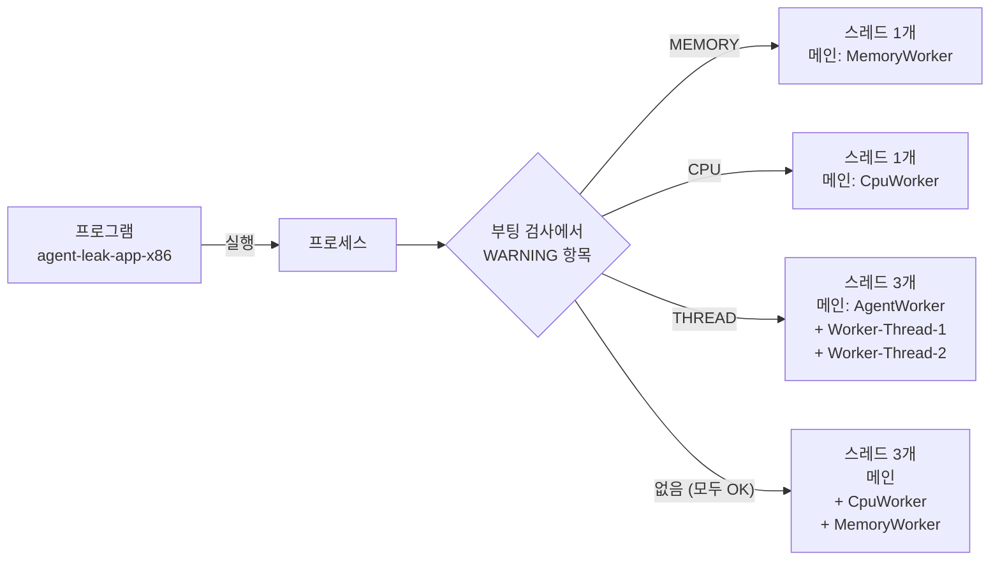

<br>

| 이름 | 하는 일 | 관련 환경변수 | 등장하는 실험 |
|---|---|---|---|
| `MemoryWorker` | 3초마다 Heap에 25MB를 할당하고 해제하지 않는다 (메모리 누수 재현) | `MEMORY_LIMIT` | OOM, Healthy |
| `CpuWorker` | 3초마다 `Current Load`를 올린다 (CPU 부하 재현) | `CPU_MAX_OCCUPY` | CPU, Healthy |
| `AgentWorker` | 동시 처리 모드에서 작업 스레드 2개를 만들고, 끝나기를 기다린다 (관리자 역할) | `MULTI_THREAD_ENABLE` | Deadlock |
| `Worker-Thread-1` | `Shared_Memory_A` Lock을 잡고, 이어서 `Socket_Pool_B`를 요청한다 | `MULTI_THREAD_ENABLE` | Deadlock |
| `Worker-Thread-2` | `Socket_Pool_B` Lock을 잡고, 이어서 `Shared_Memory_A`를 요청한다 | `MULTI_THREAD_ENABLE` | Deadlock |

<br>

| 실험 | 관제 로그 `THREADS` | 해석 |
|---|---|---|
| OOM (before/after) | 1 | 메인 스레드 하나가 MemoryWorker 작업을 직접 수행 |
| CPU before | 1 | 메인 스레드 하나가 CpuWorker 작업을 직접 수행 |
| Deadlock before | 1 → 3 | AgentWorker가 Worker-Thread 2개를 만든 시점부터 메인 포함 3개 |
| CPU after, Deadlock after (Healthy) | 1 → 3 | CpuWorker와 MemoryWorker 로그가 번갈아 찍히므로, 각각 별도 스레드로 동시에 도는 것으로 판단 |

- `Worker`라는 이름은 로그 태그이다. 이름에 Worker가 붙었다고 모두 별도 스레드인 것은 아니고, 스레드 수는 관제 로그의 `THREADS` 값으로 확인한다.
- OOM 실험은 `MULTI_THREAD_ENABLE=true`였지만 스레드가 1개였다. MEMORY와 THREAD가 동시에 WARNING이면 메모리 시나리오가 실행되었다.
- 스레드들은 같은 프로세스의 메모리(Heap)를 공유한다. 그래서 같은 자원을 두고 경쟁이 생기고, Lock이 필요해진다.

<br>

## 2. PID

PID는 `Process ID`의 약자로, 운영체제가 실행 중인 프로세스를 구분하기 위해 부여하는 번호이다. 프로그램이 응답하지 않더라도 PID가 조회된다면 프로세스 자체는 아직 종료되지 않은 상태이다.

### PID는 PCB의 한 항목이다

운영체제는 프로세스마다 `PCB`(Process Control Block, 프로세스 제어 블록)라는 관리 정보를 커널 메모리에 만든다. PID는 이 PCB 안에 들어 있는 식별자 항목이다. Linux에서는 `task_struct` 구조체가 PCB 역할을 한다.

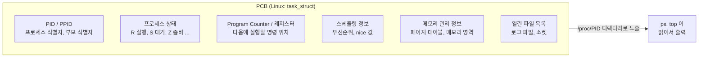

| PCB 항목 | 이번 미션에서 확인한 값 | 확인 명령 |
|---|---|---|
| PID / PPID | `PID:370 PPID:360` (OOM before) | `ps -o pid,ppid` |
| 프로세스 상태 | `STATE:SN+` (S 대기, N 낮은 우선순위, + 터미널 포그라운드) | `ps -o stat` |
| 스케줄링 정보 | `nice=10` (`SafetyGuard` 로그) | `ps -o ni` |
| 메모리 관리 정보 | `RSS:25600KB` (OOM before 시작 직후) | `ps -o rss` |
| 스레드 | `THREADS:3` (Deadlock 실험) | `ps -L -p <PID>` |

- 관제 스크립트가 기록하는 값은 결국 커널이 PCB에 들고 있는 정보를 `/proc` 파일 시스템을 통해 읽어 온 것이다.
- 컨텍스트 스위칭(CPU가 다른 프로세스로 넘어가는 것)이 일어날 때 현재 레지스터 값이 PCB에 저장되고, 다음 프로세스의 PCB에서 값을 복원한다.

<br>

### 부모와 자식 프로세스

`agent-leak-app-x86`은 Python 코드와 Python 실행 환경을 PyInstaller로 하나의 파일에 묶은 실행 파일이다 (바이너리 안에서 `PyInstaller's embedded PKG archive` 문자열 확인). 이런 파일은 실행하면 같은 이름의 프로세스가 2개 생긴다.

- **부모 프로세스 (부트로더)**: 먼저 실행되는 쪽이다. 파일 안에 묶여 있던 Python 실행 환경을 `/tmp/_MEIxxxxxx` 임시 폴더에 풀고, 자식 프로세스를 띄운 뒤 자식이 끝나기를 기다린다. 앱 기능은 하지 않는다.
- **자식 프로세스 (실제 앱)**: 풀어 놓은 Python으로 앱 코드를 실행한다. 부팅 검사, MemoryWorker, CpuWorker, 로그 출력이 모두 여기서 일어나고, 관제 스크립트가 감시하는 대상도 이 프로세스이다.

<br>

OOM before 실험의 실제 PID로 그리면 다음과 같다.

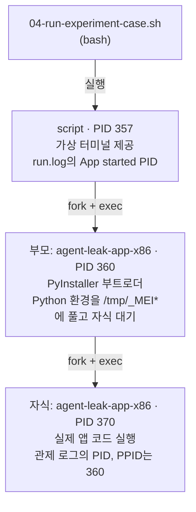

| 구분 | PID | PPID | 하는 일 | 별도 실행에서 측정한 값 |
|---|---|---|---|---|
| `script` | 357 | 04 스크립트 | 가상 터미널 제공, 종료 코드 전달 | RSS 약 3.7MB, 스레드 1 |
| 부모 (부트로더) | 360 | 357 | Python 환경 압축 해제, 자식 대기 (`wchan=do_wait`) | RSS 약 3.9MB, 스레드 1 |
| 자식 (실제 앱) | 370 | 360 | 앱 기능 전체, 로그 출력 | RSS 약 25MB부터 증가, 스레드 1~3 |

- 두 프로세스의 명령어(`CMD`)가 똑같아서 `ps`로는 구분이 어렵다. `PPID` 관계와 RSS 크기로 구분한다. 관제 스크립트는 RSS가 가장 큰 쪽을 골라 자식(실제 앱)을 감시한다.
- [before-run.log](../evidence/oom/before-run.log)의 `App started (PID: 357)`과 앱 로그의 `Self-terminating process 370`이 다른 이유도 이 구조 때문이다.
- 앱이 종료되면 부모가 `/tmp/_MEI*` 임시 폴더를 지운다 (종료 후 폴더 없음 확인).

```bash
ps -ef | grep agent-leak-app
```

PID가 존재한다는 사실만으로 프로그램이 `정상 동작한다고 판단할 수는 없다`. 

`CPU`와 `메모리 변화`, `로그 진행 여부`, `스레드 상태`도 함께 확인해야 한다.

<br>

## 3. OOM

OOM은 `Out Of Memory`의 약자로, 프로그램이나 시스템에서 사용할 수 있는 메모리가 부족한 상태를 의미한다. 프로그램이 데이터를 계속 메모리에 쌓으면 사용할 수 있는 메모리가 줄어들고, 결국 프로그램이 더 이상 정상적으로 동작하기 어려워진다.

이번 미션에서는 메모리 사용량이 `MEMORY_LIMIT`에 도달했을 때 애플리케이션의 `MemoryGuard`가 프로세스를 종료하는지 확인한다. 이는 시스템 전체가 불안정해지기 전에 애플리케이션을 종료하는 자체 보호 동작이다.

<br>

## 4. 메모리 누수

메모리 누수는 프로그램이 더 이상 필요하지 않은 데이터를 계속 참조하여 메모리에서 정리되지 않는 현상이다. 물을 계속 받으면서 비우지 않는 물통처럼, 시간이 지날수록 사용 중인 메모리가 증가한다.

이번 미션에서는 `05-monitor-app-resources.sh`, `ps`, `top`을 사용하여 `agent-leak-app`의 메모리 사용량이 시간에 따라 계속 증가하는지 확인한다. 메모리 사용량이 반복해서 증가하고 감소하지 않는다면 메모리 누수를 의심할 수 있다.

<br>

## 5. RSS

RSS는 `Resident Set Size`의 약자로, 코드, 전역변수, 힙, 스택을 모두 포함해서 프로세스가 현재 실제 물리 메모리에서 사용하고 있는 크기이다.

반면 VSZ(Virtual Set Size)는 프로세스가 OS로부터 할당받은 가상 메모리 전체 크기이다.
따라서, 동적 할당을 하면 VSZ는 증가하지만 RSS는 바로 증가하지 않고, OS가 실제로 메모리를 할당하는 시점에 Page Fault가 발생하고, 물리 RAM이 매핑되면서 RSS가 증가한다. 

즉, VSZ는 프로세스가 요청한 메모리 크기이고, RSS는 실제로 사용 중인 메모리 크기이다.

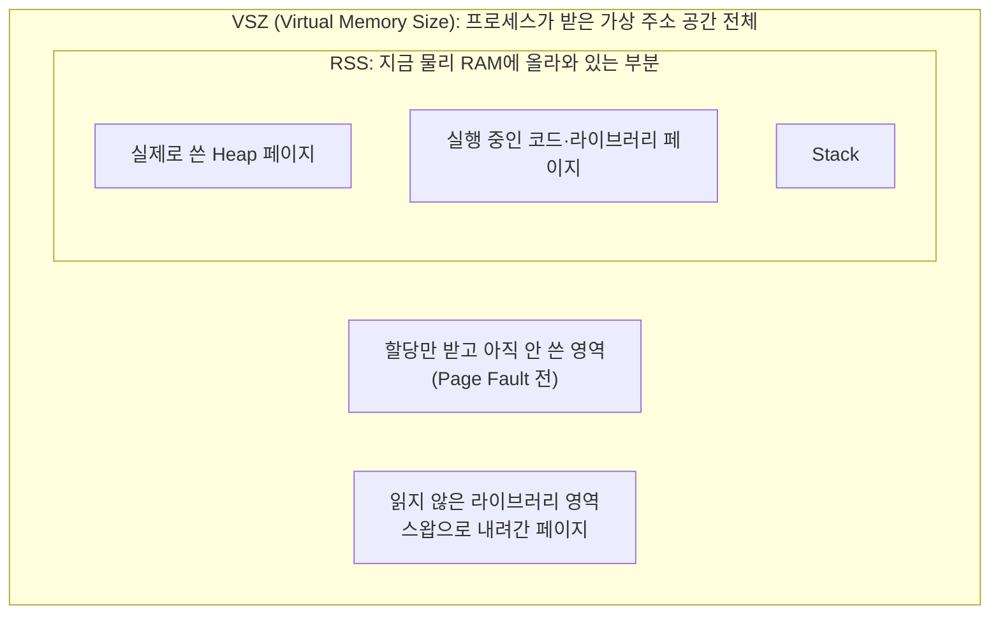

- 항상 `RSS ≤ VSZ`이다. RSS는 VSZ 중에서 실제 RAM을 차지하는 부분집합이다.
- 메모리 누수를 판단할 때는 RSS를 본다. VSZ는 예약만 해 두고 쓰지 않은 공간도 포함하므로 실제 사용량보다 크게 나온다.

앱을 실행한 채로 4초마다 `ps -o vsz,rss`를 측정한 값이다 (2026-10-27, `MEMORY_LIMIT=512`, 별도 실행).

| 시각 | 앱 로그 Heap | VSZ (KB) | RSS (KB) | VSZ - RSS (KB) |
|---|---|---|---|---|
| 19:22:29 | 25MB | 616,188 | 51,476 | 564,712 |
| 19:22:33 | 50MB | 641,800 | 77,120 | 564,680 |
| 19:22:38 | 100MB | 693,008 | 128,328 | 564,680 |
| 19:22:46 | 150MB | 744,216 | 179,536 | 564,680 |
| 19:22:50 | 200MB | 795,424 | 230,744 | 564,680 |

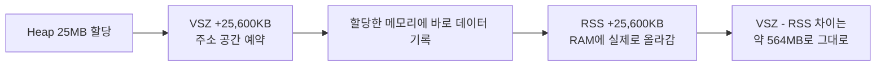

- VSZ와 RSS가 매번 같은 크기(약 25MB)로 함께 늘었다. 앱이 할당한 메모리에 바로 데이터를 써서, 예약한 공간이 곧바로 RAM에 올라갔다는 뜻이다.
- 둘의 차이(약 564MB)는 처음부터 예약만 되어 있고 쓰이지 않는 영역이다. 대부분 Python 실행 환경과 라이브러리, 스레드 스택용으로 예약된 공간으로 추정한다.
- 그래서 VSZ만 보면 이 앱은 처음부터 600MB 가까이 쓰는 것처럼 보인다. 실제 사용량과 누수 판단에는 RSS를 써야 한다.

### Page Fault란?

`Page Fault`(페이지 폴트)는 프로그램이 어떤 가상 주소에 접근했는데, 그 주소에 아직 실제 RAM이 연결되어 있지 않을 때 CPU가 커널에게 알리는 신호이다.

<br>

아래는 메모리를 요청한 순간부터 RSS가 늘어나기까지의 순서이다.

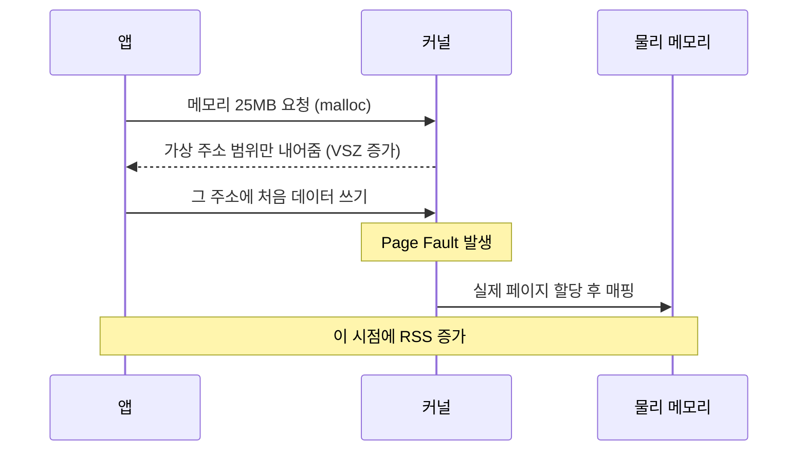

<br>

## 6. MemoryGuard

`MemoryGuard`는 애플리케이션의 메모리 사용량을 감시하는 보호 기능이다. 사용량이 `MEMORY_LIMIT`을 넘으면 시스템 전체의 불안정을 막기 위해 애플리케이션을 종료할 수 있다.

다음과 같은 로그가 기록되는지 확인한다.

```text
Memory limit exceeded
SELF-TERMINATED
```

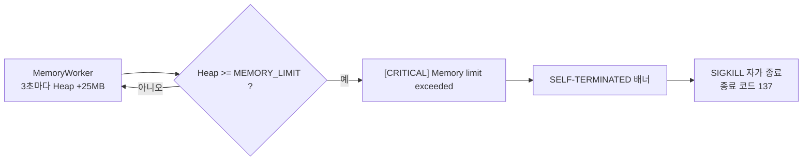

`MEMORY_LIMIT`을 높이면 프로그램이 더 오래 실행될 수 있다. 하지만 메모리 사용량이 계속 증가한다면 누수 자체가 해결된 것은 아니므로, 환경변수 변경은 임시 조치이다.

<br>

## 7. CPU와 CPU 과점유

`CPU`는 프로그램의 명령을 계산하고 처리하는 장치이다. 여러 프로세스는 CPU를 번갈아 사용하며 작업을 수행한다.

`CPU 과점유`는 특정 프로세스가 CPU를 지나치게 많이 사용하는 상태이다. 한 사람이 공용 도구를 오랫동안 독점하면 다른 사람이 기다려야 하는 것처럼, 특정 프로세스가 CPU를 과도하게 사용하면 다른 프로세스의 실행이 늦어져 시스템 응답 지연이 발생할 수 있다.

이번 미션에서는 시스템 전체 CPU 사용률만 보는 것이 아니라, `top`과 `ps`를 사용하여 `agent-leak-app`의 CPU 사용률이 급격히 상승하는지 확인한다.

<br>

## 8. CPU Latency

`Latency`는 요청을 보낸 뒤 응답을 받을 때까지 걸리는 지연 시간을 의미한다. 특정 프로세스가 CPU를 과도하게 사용하면 다른 작업이 CPU를 할당받기까지 기다리는 시간이 길어질 수 있다.

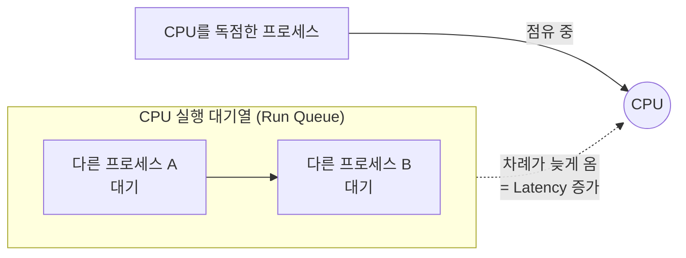

따라서 이번 미션의 CPU Latency 분석에서는 대상 프로세스의 CPU 사용률 상승과 프로그램의 응답 또는 종료 상태를 함께 확인한다.

<br>

## 9. Watchdog과 SIGTERM

`Watchdog`은 프로그램의 상태와 자원 사용량을 감시하는 보호 기능이다. CPU 사용률이 설정된 `CPU_MAX_OCCUPY`를 넘으면 시스템을 보호하기 위해 프로세스에 종료 신호를 보낼 수 있다.

`SIGTERM`은 프로세스에 정상적인 종료를 요청하는 Linux 신호이다. 다음과 같은 로그가 기록된다면 단순 오류가 아니라 Watchdog의 보호 조치로 종료되었는지 분석한다.

```text
WATCHDOG
INITIATING EMERGENCY ABORT
SIGTERM
```

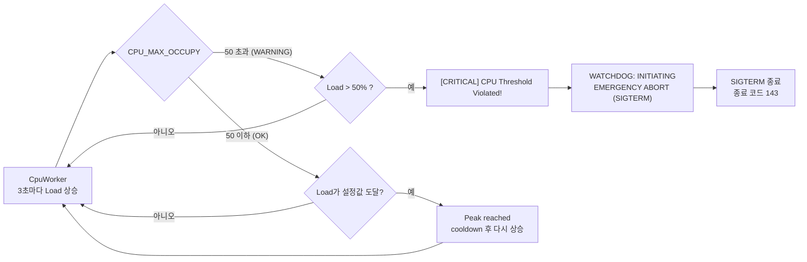

- 실험에서는 `CPU_MAX_OCCUPY`를 80, 90 어느 쪽으로 설정해도 실제 종료는 Load가 50%를 넘는 순간 일어났다.
- 종료 배너가 처음에 로그에 남지 않았던 이유는 [06-troubleshooting.md](./06-troubleshooting.md)에 정리했다.

`CPU_MAX_OCCUPY`를 높이는 것은 Watchdog의 종료 기준을 변경하는 조치이다. 프로그램이 사용하는 CPU 자체를 줄이는 근본 해결책은 아니다.

<br>

## 10. Deadlock

`Deadlock`은 교착상태라는 뜻이다. 둘 이상의 스레드가 서로 상대방이 가진 자원을 기다리면서 아무도 다음 작업으로 진행하지 못하는 상태이다.

```text
예를 들어 스레드 A가 펜을 가진 상태에서 노트를 기다리고, 스레드 B가 노트를 가진 상태에서 펜을 기다린다고 가정한다. A는 B가 노트를 놓기를 기다리고, B는 A가 펜을 놓기를 기다린다. 두 스레드 모두 가진 것을 놓지 않기 때문에 기다림이 끝나지 않는다.
```

이번 실험의 실제 로그를 그림으로 그리면 다음과 같다. 화살표가 원을 그리며 닫히는 것이 순환 대기이다.

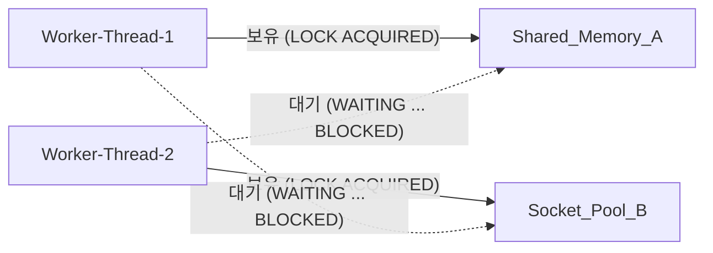

Deadlock이 발생해도 프로세스가 바로 종료되는 것은 아니다. PID는 존재하지만 CPU와 메모리 사용량의 변화가 거의 없고, 새로운 로그도 출력되지 않는 무응답 상태가 나타날 수 있다.

<br>

## 10-1. Deadlock의 네 가지 조건

Deadlock은 다음 네 가지 조건이 모두 성립할 때 발생할 수 있다. 하나라도 깨면 Deadlock은 생기지 않는다.

조건 하나하나는 평범한 상황이다. 예를 들어 점유 대기만 있으면 기다리던 자원이 풀리는 순간 다시 진행된다. 네 조건이 동시에 겹쳐 기다림이 원을 이룰 때만 영원히 멈춘다. 그래서 아래 표는 네 조건이 한 장면에서 동시에 일어나는 **교차로 꼬리물기**로 비유했다.


| 조건 | 뜻 | 이번 실험의 증거 | 조건을 깨는 방법 |
|---|---|---|---|
| 상호 배제 (Mutual Exclusion) | 자원 하나를 한 번에 한 스레드만 사용 | `CAUTION: Strict resource locking is enabled.` | 읽기 전용 공유, Lock 없는 자료구조 |
| 점유 대기 (Hold and Wait) | 자원을 가진 채로 다른 자원을 기다림 | `LOCK ACQUIRED ... (Holding...)` 후 `Need resource ...` | 필요한 Lock을 한 번에 모두 요청 (교차로가 통째로 빌 때만 진입) |
| 비선점 (No Preemption) | 남이 가진 자원을 강제로 빼앗을 수 없음 | `WAITING ... (Status: BLOCKED)`가 끝나지 않음 | `tryLock(timeout)` 실패 시 보유 Lock 반납 (오래 막히면 후진해서 칸을 비움) |
| 순환 대기 (Circular Wait) | 대기 관계가 원을 이룸 | Thread-1 → `Socket_Pool_B` → Thread-2 → `Shared_Memory_A` → Thread-1 | 모든 스레드의 Lock 획득 순서 통일 (일방통행 규칙) |

- 이번 실험은 차가 2대인 경우이다. Thread-1은 `Shared_Memory_A` 칸을 차지한 채 `Socket_Pool_B` 칸을, Thread-2는 `Socket_Pool_B` 칸을 차지한 채 `Shared_Memory_A` 칸을 기다린다.

이번 미션에서는 PID 존재 여부, CPU와 메모리의 정체, 마지막 로그의 `WAITING` 또는 `BLOCKED` 메시지를 함께 확인한다. 이 증거를 바탕으로 스레드들이 서로의 Lock을 기다리고 있는지 논리적으로 설명한다.

<br>

## 11. Lock

`Lock`은 여러 스레드가 같은 데이터나 자원을 동시에 변경하지 못하도록 접근을 제한하는 장치이다. 한 번에 한 사람만 사용할 수 있는 화장실 열쇠와 비슷하다.

Lock 자체는 데이터를 안전하게 보호하기 위해 필요하다. 하지만 여러 스레드가 서로 다른 Lock을 다른 순서로 획득하면 Deadlock이 발생할 수 있다.

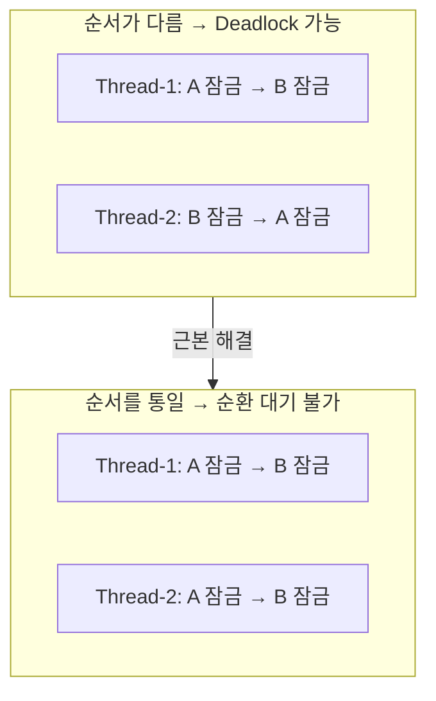

<br>
<br>

[README로 돌아가기](../README.md)
