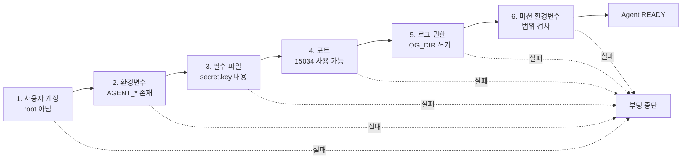

# B1-2 실행 환경

agent-leak-app 부트 시퀀스를 통과하기 위한 조건과 준비 명령을 정리한다.

<br>

## 필수 조건

애플리케이션 실행 전 다음 조건을 확인한다.
조건이 충족되지 않으면 부트 시퀀스에서 자동으로 실패 처리된다.

| 항목 | 설정 조건 |
|---|---|
| 실행 계정 | root가 아닌 일반 사용자 |
| `AGENT_HOME` | 필수 환경변수 |
| `AGENT_PORT` | `15034` |
| `AGENT_UPLOAD_DIR` | `$AGENT_HOME/upload_files`이며 디렉터리가 존재해야 함 |
| `AGENT_KEY_PATH` | `$AGENT_HOME/api_keys`이며 경로가 존재해야 함 |
| `AGENT_LOG_DIR` | 디렉터리가 존재하고 쓰기 권한이 있어야 함 |
| `MEMORY_LIMIT` | 50부터 512 사이의 정수이며 단위는 MB |
| `CPU_MAX_OCCUPY` | 10부터 100 사이의 정수이며 단위는 % |
| `MULTI_THREAD_ENABLE` | `true` 또는 `false` |
| `secret.key` | `$AGENT_HOME/api_keys/secret.key`에 존재해야 함 |
| `secret.key` 내용 | `agent_api_key_test` |
| 네트워크 | `0.0.0.0:15034`에 바인딩할 수 있어야 함 |

<br>

앱은 실행되면 아래 6단계를 순서대로 검사하고, 하나라도 실패하면 바로 종료한다.



- 6단계에서 `MEMORY_LIMIT`, `CPU_MAX_OCCUPY`, `MULTI_THREAD_ENABLE`이 범위 안이면 부팅은 통과한다. 권장값에서 벗어난 값은 `WARNING`으로 표시되고, 그 값에 맞는 장애 시나리오가 실행된다.

<br>

## 환경변수 설정 예시

다음 값은 형식을 보여 주는 예시이다. 실제 실험에서는 사용한 경로와 설정값을 기록한다.

```bash
export AGENT_HOME="/path/to/agent-home"
export AGENT_PORT="15034"
export AGENT_UPLOAD_DIR="$AGENT_HOME/upload_files"
export AGENT_KEY_PATH="$AGENT_HOME/api_keys"
export AGENT_LOG_DIR="$AGENT_HOME/logs"

export MEMORY_LIMIT="100"
export CPU_MAX_OCCUPY="50"
export MULTI_THREAD_ENABLE="true"
```

<br>

## 필수 디렉터리와 파일 생성

```bash
mkdir -p "$AGENT_UPLOAD_DIR"
mkdir -p "$AGENT_KEY_PATH"
mkdir -p "$AGENT_LOG_DIR"

printf '%s' 'agent_api_key_test' > "$AGENT_KEY_PATH/secret.key"
```

<br>
<br>

[README로 돌아가기](../README.md)
