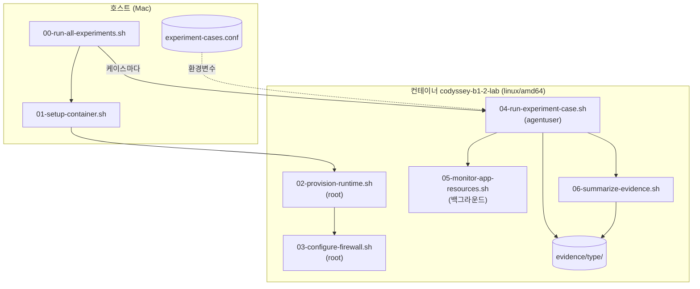
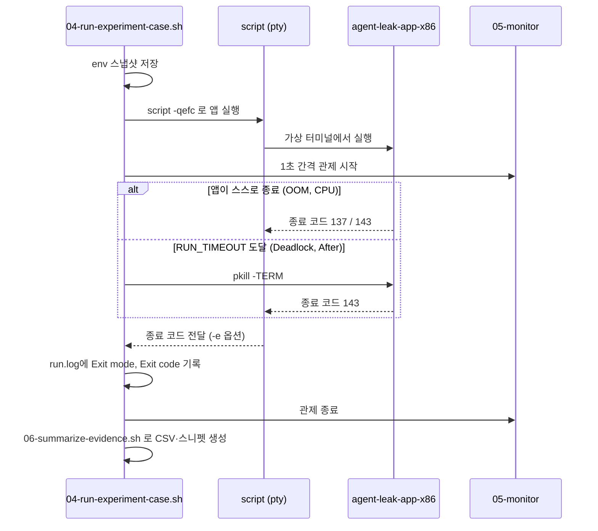

# B1-2 스크립트 구성과 실행 방법

실험 자동화 스크립트의 구조, 실행 방법, 관제 로그 형식을 정리한다.

<br>

## 구조

미션에서 필수로 요구하는 파일만 중심으로 구성한다. 보너스 과제는 실제로 수행할 때 별도의 리포트를 추가한다.

```text
Codyssey-B1-2/
├── README.md
├── .gitignore
├── docs/                            # README 상세 문서
├── bin/
│   └── agent-leak-app-x86
├── scripts/
│   ├── experiment-cases.conf        # 실험 케이스별 환경변수
│   ├── 00-run-all-experiments.sh    # 전체 실행 진입점 (호스트)
│   ├── 01-setup-container.sh        # 컨테이너 생성·시작 + 프로비전 + 방화벽 (호스트)
│   ├── 02-provision-runtime.sh      # 패키지·사용자·디렉터리·agent.env 준비 (root)
│   ├── 03-configure-firewall.sh     # UFW 포트 정책 적용 (root)
│   ├── 04-run-experiment-case.sh    # 케이스 1개 실행 + 원본 로그 저장 (agentuser)
│   ├── 05-monitor-app-resources.sh  # 앱 프로세스·시스템 자원 주기 기록
│   └── 06-summarize-evidence.sh     # 원본 로그 → CSV·리포트 스니펫
├── reports/
│   ├── 01-oom-report.md
│   ├── 02-cpu-report.md
│   └── 03-deadlock-report.md
└── evidence/
    ├── oom/
    ├── cpu/
    └── deadlock/
```

<br>

## 각 스크립트의 역할

`00-run-all-experiments.sh`는 순서만 조율하고, 각 단계는 한 가지 책임을 가진 스크립트가 담당한다.



<br>

### 04-run-experiment-case.sh 한 케이스의 진행 순서



- 앱을 `script`로 감싸는 이유는 [06-troubleshooting.md](./06-troubleshooting.md)에 정리했다.

| 스크립트 | 실행 주체 | 실행 시점 | 역할 |
| --- | --- | --- | --- |
| 00-run-all-experiments.sh | 호스트 사용자 | 실험 전체를 돌릴 때 | 셋업 후 `experiment-cases.conf`의 케이스를 순서대로 실행 |
| 01-setup-container.sh | 호스트 사용자 | 실험 전 (00-run-all-experiments.sh가 호출) | 컨테이너 생성·시작, provision·방화벽 실행 |
| experiment-cases.conf | - | - | 케이스 이름과 케이스별 환경변수 정의 (데이터) |
| 02-provision-runtime.sh | root | 컨테이너 생성 직후 | 패키지 설치, 사용자·경로·`agent.env` 준비 |
| 03-configure-firewall.sh | root | provision 이후 | UFW 규칙·포트 정책 구성 |
| 04-run-experiment-case.sh | agentuser | 케이스마다 | 앱을 pty(`script`)로 실행, monitor 실행, `RUN_TIMEOUT` 처리, 종료 코드 기록, 원본 로그(app·monitor·run·env) 저장 |
| 05-monitor-app-resources.sh | agentuser | 앱 실행 중 | 프로세스·CPU·메모리·RSS·스레드·포트 상태 기록 |
| 06-summarize-evidence.sh | agentuser | run-experiment 마지막, 또는 단독 | 원본 로그로 시계열 CSV·리포트 스니펫 생성 (실험 없이 재생성 가능) |

<br>

## 실행 방법

파일 이름 앞 번호는 실행 순서이다. `00`이 전체를 순서대로 실행하고, 각 단계는 아래처럼 따로 실행할 수도 있다.

```bash
# 전체: 셋업 + 6개 실험 (약 8분, 레포 루트에서)
bash scripts/00-run-all-experiments.sh

# 특정 케이스만: 셋업 + 지정 케이스
bash scripts/00-run-all-experiments.sh cpu-before cpu-after

# 셋업 없이 특정 케이스만 (컨테이너가 이미 준비된 경우)
SKIP_SETUP=1 bash scripts/00-run-all-experiments.sh deadlock-before
```

| 단계 | 개별 실행 명령 | 실행 위치 |
| --- | --- | --- |
| 01 셋업 전체 | `bash scripts/01-setup-container.sh` | 호스트 |
| 02 프로비전 | `docker exec codyssey-b1-2-lab ./scripts/02-provision-runtime.sh` | 컨테이너 (root) |
| 03 방화벽 | `docker exec codyssey-b1-2-lab ./scripts/03-configure-firewall.sh` | 컨테이너 (root) |
| 04 케이스 1개 (값 직접 지정) | `docker exec -u agentuser -e MEMORY_LIMIT=100 codyssey-b1-2-lab ./scripts/04-run-experiment-case.sh oom-before` | 컨테이너 (agentuser) |
| 05 모니터만 | `docker exec -u agentuser codyssey-b1-2-lab ./scripts/05-monitor-app-resources.sh` | 컨테이너 (agentuser) |
| 06 CSV·스니펫 재생성 | `docker exec -u agentuser codyssey-b1-2-lab ./scripts/06-summarize-evidence.sh oom-before` | 컨테이너 (agentuser) |

- `04`를 직접 실행할 때 `-e`로 넘기지 않은 변수는 `agent.env` 기본값(100 / 50 / true)이 쓰인다. `experiment-cases.conf`의 값으로 돌리려면 `00`에 케이스 이름을 넘기는 방식을 쓴다.

케이스별 설정값은 [`scripts/experiment-cases.conf`](../scripts/experiment-cases.conf)에서 관리한다.

| 케이스 | MEMORY_LIMIT | CPU_MAX_OCCUPY | MULTI_THREAD_ENABLE | RUN_TIMEOUT |
| --- | --- | --- | --- | --- |
| oom-before | **100** | 50 | true | - |
| oom-after | **256** | 50 | true | - |
| cpu-before | 512 | **90** | false | 120s |
| cpu-after | 512 | **50** | false | 120s |
| deadlock-before | 512 | 50 | **true** | 120s |
| deadlock-after | 512 | 50 | **false** | 120s |

- 각 실험은 굵게 표시한 변수만 바꾸고, 나머지는 다른 장애가 먼저 일어나지 않도록 고정한다.
- 세 값이 모두 권장 범위면 앱이 `Healthy System Monitoring` 시나리오로 종료 없이 계속 동작한다. 그래서 CPU·Deadlock 실험에는 `RUN_TIMEOUT`(초)을 걸어 시간이 지나면 앱을 종료하고 증적을 수집한다. 종료 방식과 종료 코드(`143 (SIGTERM)` 등)는 각 `*-report-snippet.md`와 `*-run.log`에 기록된다.
- 기존 컨테이너가 `--platform linux/amd64` 없이 만들어졌다면 `docker rm -f codyssey-b1-2-lab` 후 다시 실행한다.

<br>

## 05-monitor-app-resources.sh 관제 로그 형식 및 지표 설명

`05-monitor-app-resources.sh`는 프로세스와 시스템의 핵심 자원을 1초 간격으로 수집하여 `monitor.log`에 한 줄씩 기록한다.

```text
[2026-09-10 16:19:27] PID:7237 PPID:7223 STATE:SN ELAPSED:00:00 THREADS:1 PROC_CPU:4.3% PROC_MEM:0.1% RSS:18352KB SYS_CPU:1.6% SYS_MEM:3.6% DISK_USED:1% PORT:15034 FIREWALL:active CMD:/workspace/bin/agent-leak-app-x86
```

| 항목 | 예시 값 | 기술적 의미 | 수집 목적 및 용도 |
| :--- | :--- | :--- | :--- |
| **타임스탬프** | `[2026-09-10 16:19:27]` | 스냅샷이 수집된 시각 | **시계열 차트의 X축**, 장애 발생 시각 특정, 프로그램 로그와의 교차 검증용 |
| **`PID`** | `7237` | Process ID (프로세스 고유 식별자) | 대상 프로세스 정상 구동 여부 확인 및 제어/디버깅 대상 지정 |
| **`PPID`** | `7223` | Parent Process ID (부모 프로세스 ID) | 프로세스를 실행한 부모 셸 식별 및 프로세스 계층 트리 추적 |
| **`STATE`** | `SN+` | 프로세스 상태 플래그 (`S`: Sleep 대기, `N`: Nice 저우선순위, `l`: 멀티스레드, `+`: 터미널 포그라운드 그룹) | 프로세스의 실행/대기/좀비/교착상태 여부 진단 |
| **`ELAPSED`** | `00:00` | 누적 실행 시간 (`MM:SS`) | 프로세스 시작 후 경과 시간, **프로세스 생존 시간(Survival Time)** 측정용 |
| **`THREADS`** | `1` | 프로세스 내 활성 스레드 개수 | 멀티스레드 여부, 스레드 누수 감지, **Deadlock 장애 식별용** |
| **`PROC_CPU`** | `4.3%` | 프로세스 단독 CPU 코어 사용률 | **CPU 과점유 장애(CPU Spike/Loop) 진단**용 |
| **`PROC_MEM`** | `0.1%` | 시스템 전체 물리 메모리 대비 점유율 (%) | 전체 시스템 관점에서 대상 프로세스의 메모리 점유 비중 확인 |
| **`RSS`** | `18352KB` | Resident Set Size (실제 물리 메모리 점유 크기, 1MB=1024KB) | **메모리 누수(Memory Leak) 진단의 핵심 지표**, 시간에 따른 증가 추세 추적 |
| **`SYS_CPU`** | `1.6%` | 시스템 전체 CPU 사용률 | 부하 원인이 대상 프로세스인지, 시스템 전체 문제인지 비교 판별 |
| **`SYS_MEM`** | `3.6%` | 시스템 전체 물리 메모리 사용률 | OS 레벨의 시스템 OOM 발생 위험 여부 감시 |
| **`DISK_USED`** | `1%` | 루트 파티션(`/`) 디스크 사용률 | 로그 폭증 등으로 인한 디스크 풀(Disk Full) 장애 방지 |
| **`PORT`** | `15034` | 바인딩된 서비스 포트 번호 | 서비스 헬스체크 (포트 리슨 정상 여부 확인) |
| **`FIREWALL`** | `active` | 시스템 방화벽(`ufw`) 상태 | 보안 규칙 준수 여부 및 트래픽 차단 원인 규명 |
| **`CMD`** | `/workspace/bin/...` | 실제 실행된 바이너리/명령어 경로 | 모니터링 대상 프로그램의 바이너리 경로 검증 |

<br>
<br>

[README로 돌아가기](../README.md)
