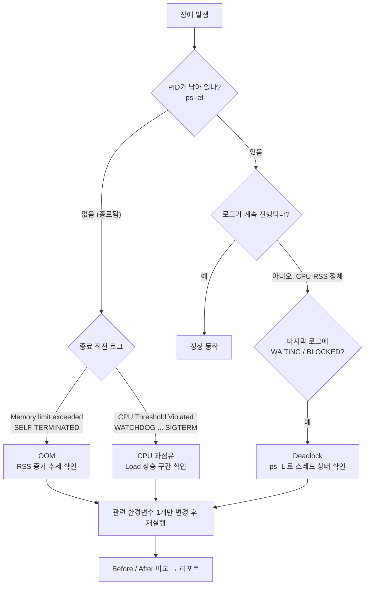

# B1-2 장애 분석 방법과 리포트 작성

장애 유형별 분석 절차, 증거 수집 명령어, 리포트 작성 기준을 정리한다.

<br>

## 장애 유형별 분석 절차



- 종료 코드도 함께 본다. `137`(128+9)은 SIGKILL, `143`(128+15)은 SIGTERM으로 종료된 것이다.

<br>

### 1. OOM 분석

`05-monitor-app-resources.sh`를 사용하여 시간에 따른 메모리 사용량을 확인한다. 한 번의 측정값만 보는 것이 아니라, 시작부터 종료까지 여러 시점의 값을 기록하여 메모리가 계속 증가하는지 확인한다.

종료 직전과 직후의 프로그램 로그에서 `Memory limit exceeded`, `SELF-TERMINATED`와 같은 메시지를 찾는다. 이를 근거로 메모리 임계치 초과와 `MemoryGuard`의 종료 동작을 연결한다.

`MEMORY_LIMIT`을 변경하기 전과 변경한 후에 각각 실행한다. 다음 항목을 비교한다.

- 시간에 따른 메모리 사용량
- 종료 직전 메모리 사용량
- 프로세스 생존 시간
- 프로세스 종료 여부
- `MemoryGuard` 관련 로그

설정값을 높인 후 생존 시간이 증가하더라도 메모리가 계속 증가한다면 임시 조치만 성공한 것이다. 근본 원인인 메모리 누수는 해결되지 않은 것으로 판단한다.

<br>

### 2. CPU 과점유 분석

`05-monitor-app-resources.sh`, `top`, `ps`를 사용하여 CPU 사용률이 급격히 상승하는 구간을 찾는다. 시스템 전체가 아닌 `agent-leak-app` 프로세스의 CPU 사용률이 높아졌는지 확인한다.

종료 전후의 프로그램 로그에서 `WATCHDOG`, `SIGTERM`과 같은 메시지를 찾는다. 이를 근거로 CPU 임계치 초과와 Watchdog의 보호 동작을 연결한다. 이 메시지는 출력이 파일로 리다이렉트되면 사라질 수 있으므로, 종료 코드(143)를 함께 확인한다. 자세한 내용은 [06-troubleshooting.md](./06-troubleshooting.md)를 참고한다.

`CPU_MAX_OCCUPY`를 변경하기 전과 변경한 후에 각각 실행한다. 다음 항목을 비교한다.

- CPU 사용률 상승 구간
- 관측된 최대 CPU 사용률
- 프로세스 생존 시간
- 프로세스 종료 여부
- Watchdog 관련 로그

설정값을 높인 뒤 프로세스가 더 오래 실행되어도 CPU 사용률 자체가 계속 높다면 근본 원인은 해결되지 않은 것이다.

<br>

### 3. Deadlock 분석

먼저 `ps -ef`를 사용하여 `agent-leak-app`의 PID가 계속 존재하는지 확인한다. PID가 존재한다면 프로세스가 종료되지 않았다는 의미이다.

다음으로 `top -H` 또는 `ps -L`을 사용하여 프로세스 내부의 스레드 상태를 확인한다. CPU와 메모리 사용량의 변화가 거의 없고 프로그램 로그가 `WAITING`, `BLOCKED` 이후 멈췄는지 확인한다.

`MULTI_THREAD_ENABLE=true`와 `MULTI_THREAD_ENABLE=false` 상태에서 각각 실행한다. 다음 항목을 비교한다.

- PID 유지 여부
- CPU와 메모리 변화
- 로그가 마지막으로 기록된 위치
- 스레드 상태
- 무응답 발생 여부

`true`일 때 무응답이 발생하고 `false`일 때 정상적으로 진행된다면, 멀티스레드 환경의 자원 경쟁이 문제와 관련되어 있다고 추론할 수 있다. 단순히 프로그램이 멈췄다는 사실만으로 Deadlock이라고 확정하지 않고, 여러 증거를 함께 제시한다.

<br>
<br>

## 증거 수집 명령어

### 프로세스 확인

```bash
ps -ef | grep agent-leak-app
```

### CPU와 메모리 확인

```bash
ps -p <PID> -o pid,ppid,stat,etime,%cpu,%mem,rss,cmd

top -p <PID>
```

### 스레드 상태 확인

```bash
top -H -b -n 2 -d 1 -p <PID>

ps -L -p <PID> -o pid,tid,stat,%cpu,%mem,rss,etime,wchan:20,comm
```

- `top -H -b -n 2 -d 1`: 스레드별로 1초 간격 2회 측정한다. 1회차는 누적값이라 2회차(직전 1초의 순간 CPU)를 본다.
- `wchan`: 스레드가 커널 안에서 잠들어 있는 함수 이름이다. `futex_wait`면 Lock 대기, `do_select`면 작업 사이 sleep이다.
- 실험 중에는 `07-capture-system-tools.sh`가 위 명령과 `ps -ef`를 3초마다 실행해 `evidence/<type>/<phase>-systools.log`에 저장한다.

### 실행 조건과 시각 기록

```bash
date

env | grep -E \
'AGENT_|MEMORY_LIMIT|CPU_MAX_OCCUPY|MULTI_THREAD_ENABLE'
```

명령어를 실행한 시각을 함께 기록한다. 같은 시간대의 관제 로그와 프로그램 로그를 연결하면 장애 발생 순서를 설명하기 쉽다.

<br>
<br>

## 장애 리포트 작성

### 공통 템플릿

```markdown
# [Bug] 장애 유형 - 한 줄 요약

### 1. Description

- 발생 시각:
- 실행 환경:
- 적용한 환경변수:
- 발생 조건:
- 관측한 현상:

### 2. Evidence & Logs

- 05-monitor-app-resources.sh 관제 데이터:
- 프로그램 실행 로그:
- Linux 명령어 출력:
- 스크린샷:

### 3. Root Cause Analysis

- 증거로 직접 확인한 사실:
- 증거를 바탕으로 추론한 원인:
- 관련 운영체제 동작 원리:

### 4. Workaround & Verification

- 변경한 환경변수:
- 변경 전 결과:
- 변경 후 결과:
- 임시 조치의 한계:
- 근본적인 해결 제안:
```

### 관측 사실과 원인 추론

관측한 사실과 원인에 대한 추론을 구분하여 작성한다. 

```text
관측 사실:
05-monitor-app-resources.sh에서 프로세스의 메모리 사용량이 시간에 따라 증가했다.
MEMORY_LIMIT에 도달한 직후 SELF-TERMINATED 로그와 함께 프로세스가 종료되었다.

원인 추론:
프로그램이 사용한 메모리를 정상적으로 정리하지 않아 사용량이 증가한 것으로 보인다.
MemoryGuard가 설정된 임계치를 감지하여 프로세스를 종료한 것으로 판단한다.
```

<br>
<br>

[README로 돌아가기](../README.md)
