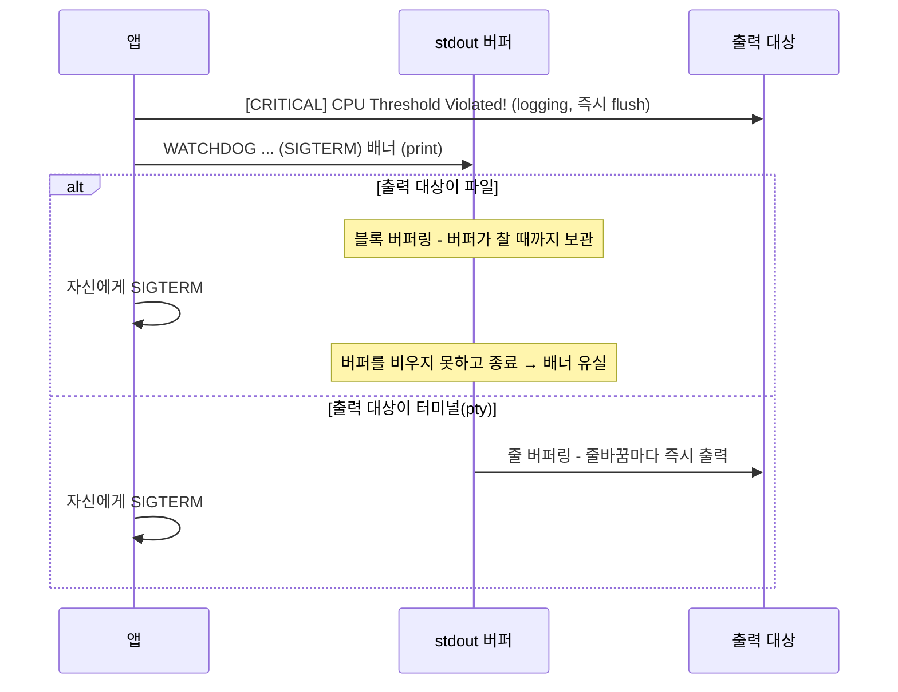
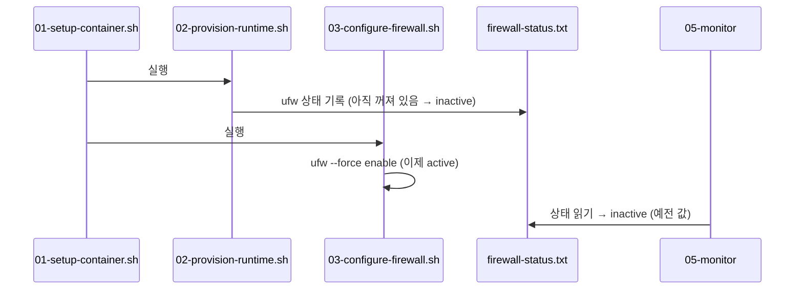

# B1-2 트러블슈팅

실험을 진행하며 만난 문제와 원인, 해결 과정을 정리한다.

## 1. 종료 로그(WATCHDOG, SELF-TERMINATED)가 남지 않음

### 증상

미션 안내에는 CPU 임계치를 넘으면 `WATCHDOG`, `SIGTERM` 로그와 함께 종료된다고 되어 있다. 하지만 처음 수집한 `cpu-before` 로그는 아래 줄에서 끝났다.

```text
2026-10-13 20:58:28,312 [INFO] [CpuWorker] Current Load: 51.29%
2026-10-13 20:58:28,419 [CRITICAL] [CpuWorker] CPU Threshold Violated! (51.290000000000006%).
```

- 실행 스크립트 출력은 `Exit mode: 앱 자체 종료`뿐이었고, 어떤 신호로 종료됐는지 알 수 없었다.
- 같은 과제를 수행한 다른 사람의 로그에는 `>>> [SYSTEM] WATCHDOG: INITIATING EMERGENCY ABORT (SIGTERM) <<<`이 찍혀 있었다.
- 처음에는 이 앱이 Watchdog 없이 내부에서 바로 종료한다고 해석했다. 아래 확인 결과 이 해석은 틀렸다.

<br>

### 확인 1. 종료 코드 기록

기존 `04-run-experiment-case.sh`는 `wait "$APP_PID" || true`로 종료 코드를 버리고 있었다. 같은 조건으로 앱을 직접 실행해 종료 코드를 확인했다.

```bash
# 컨테이너 안에서 agentuser 로 실행
PYTHONUNBUFFERED=1 /workspace/bin/agent-leak-app-x86 > /tmp/cpu90.out 2>&1 &
P=$!                  # 앱 PID 저장
wait $P               # 앱이 끝날 때까지 대기
echo "EXIT=$?"        # 종료 코드 출력
```

```text
EXIT=143
2026-10-27 18:54:20,213 [CRITICAL] [CpuWorker] CPU Threshold Violated! (55.0%).
```

- 종료 코드 143은 `128 + 15`이다. 15번 신호는 `SIGTERM`이다.
- 즉, 로그에는 없었지만 앱은 SIGTERM으로 종료되고 있었다.

<br>

### 확인 2. 가상 터미널(pty)에서 실행

출력 대상만 파일에서 터미널로 바꿔 같은 조건으로 실행했다. `script`는 가상 터미널을 만들어 그 안에서 명령을 실행하는 도구이다.

```bash
# -q: 안내문 생략, -e: 자식 종료 코드 반환, -c: 실행할 명령
script -qec "/workspace/bin/agent-leak-app-x86" /tmp/cpu80-pty.out > /dev/null 2>&1
echo "EXIT=$?"
```

```text
EXIT=143
2026-10-27 18:55:20,794 [CRITICAL] [CpuWorker] CPU Threshold Violated! (52.05%).

>>> [SYSTEM] WATCHDOG: INITIATING EMERGENCY ABORT (SIGTERM) <<<
```

| 실행 방식 | 종료 코드 | 마지막 로그 |
|---|---|---|
| 파일로 리다이렉트 (`> file 2>&1`) | 143 | `CPU Threshold Violated!` |
| 가상 터미널 (`script`) | 143 | `WATCHDOG: INITIATING EMERGENCY ABORT (SIGTERM)` |

종료 방식은 같고, 출력 방식에 따라 배너만 사라진다는 것을 확인했다.

<br>

### 원인



- `[INFO]`, `[CRITICAL]` 줄은 logging 모듈이 한 줄 쓸 때마다 flush 하므로 파일에도 남는다.
- `>>> [SYSTEM] ... <<<` 배너는 일반 출력(print)으로 보인다. 일반 출력은 대상이 터미널이면 줄 단위로, 파일이면 큰 블록 단위로 모았다가 내보낸다.
- 앱은 배너를 출력한 직후 스스로 SIGTERM을 받고 종료된다. SIGTERM의 기본 동작은 버퍼를 비우지 않고 프로세스를 끝내는 것이라, 파일 모드에서는 배너가 버퍼 안에서 사라진다.
- `PYTHONUNBUFFERED=1`을 지정했지만 효과가 없었다. 이 앱은 Python 실행 환경을 하나로 묶은 실행 파일이라 이 환경변수를 적용하지 않는 것으로 추정한다.

<br>

### 같은 문제가 OOM에도 있었음

OOM 케이스도 pty로 실행해 보니 파일 로그에 없던 배너와 종료 코드가 확인됐다.

```text
>>> [SYSTEM] SELF-TERMINATED (Memory Limit Exceeded) <<<
Killed
EXIT=137
```

- 137은 `128 + 9`, 즉 `SIGKILL`이다. MemoryGuard는 SIGKILL로 자신을 종료한다.
- CPU의 Watchdog(SIGTERM)과 OOM의 MemoryGuard(SIGKILL)는 종료 신호가 다르다는 것도 이 과정에서 확인했다.

<br>

### 해결

[04-run-experiment-case.sh](../scripts/04-run-experiment-case.sh)를 다음과 같이 수정하고 6개 케이스를 모두 다시 실행했다.

| 항목 | 변경 전 | 변경 후 |
|---|---|---|
| 앱 실행 | `PYTHONUNBUFFERED=1 "$APP_PATH" > "$APP_LOG" 2>&1 &` | `script -qefc "exec $APP_PATH" /dev/null > "$APP_LOG" 2>&1 &` |
| 종료 코드 | `wait "$APP_PID" \|\| true` (버림) | `wait "$APP_PID" \|\| APP_EXIT=$?` 후 `Exit code: 143 (SIGTERM)` 기록 |
| 타임아웃 종료 | `kill "$APP_PID"` | `pkill -TERM -f "^$APP_PATH"` (앱 본체에 직접 전달) |
| 로그 정리 | 없음 | pty 줄 끝의 `\r` 제거 (`sed -i 's/\r$//'`) |

- `script -f`: 출력이 생길 때마다 바로 내보낸다.
- `script -e`: 앱의 종료 코드를 그대로 돌려준다. 이 옵션이 없으면 항상 0이 나온다.
- `exec`: 중간 셸 없이 앱이 `script`의 직접 자식이 되게 한다.
- 타임아웃 시 `script` 프로세스만 죽이면 앱은 같이 종료되지만 종료 코드가 0으로 기록됐다. 그래서 앱 본체에 SIGTERM을 보내도록 바꿨다.

<br>

### 다시 실행한 결과

2026-10-27 19:11 ~ 19:19 `bash scripts/00-run-all-experiments.sh` 결과이다. 처음에는 보이지 않던 배너가 모든 케이스에서 기록되었다.

| 케이스 | 종료 방식 | 종료 코드 | 새로 보이게 된 로그 |
|---|---|---|---|
| oom-before | 앱 자체 종료 | 137 (SIGKILL) | `>>> [SYSTEM] SELF-TERMINATED (Memory Limit Exceeded) <<<` |
| oom-after | 앱 자체 종료 | 137 (SIGKILL) | `>>> [SYSTEM] SELF-TERMINATED (Memory Limit Exceeded) <<<` |
| cpu-before | 앱 자체 종료 | 143 (SIGTERM) | `>>> [SYSTEM] WATCHDOG: INITIATING EMERGENCY ABORT (SIGTERM) <<<` |
| cpu-after | RUN_TIMEOUT 종료 | 143 (SIGTERM) | `ALL CONFIGURATIONS OPTIMAL`, `MEMORY RECOVERED (Cache Cleared)` |
| deadlock-before | RUN_TIMEOUT 종료 | 143 (SIGTERM) | 없음 (BLOCKED 이후 출력 자체가 없음) |
| deadlock-after | RUN_TIMEOUT 종료 | 143 (SIGTERM) | `ALL CONFIGURATIONS OPTIMAL`, `MEMORY RECOVERED (Cache Cleared)` |

- RUN_TIMEOUT 종료의 143은 실행 스크립트가 보낸 SIGTERM이다. Watchdog 종료와 구분하기 위해 `Exit mode`를 함께 기록한다.
- 실행 방식이 바뀌면서 관제 로그의 `STATE`에 `+`가 붙었다 (예: `SN` → `SN+`). 가상 터미널의 포그라운드 프로세스 그룹이라는 뜻이며, 앱 동작과는 관계없다.

<br>

### 배운 점

- 로그에 메시지가 없다는 것이 그 동작이 없었다는 증거는 아니다. 종료 코드처럼 다른 경로의 증거로 교차 확인해야 한다.
- 출력 버퍼링은 대상이 터미널인지 파일인지에 따라 달라진다. 비정상 종료 직전의 메시지는 파일 로그에서 사라질 수 있다.
- 종료 코드 `128 + N`은 N번 신호로 종료됐다는 뜻이다. `kill -l 15` → `TERM`, `kill -l 9` → `KILL`로 확인할 수 있다.

<br>

## 2. 관제 로그의 FIREWALL 값이 inactive로 기록됨

### 증상

컨테이너를 재시작한 뒤 전체 실험을 돌리자, ufw는 실제로 `Status: active`인데 관제 로그에는 `FIREWALL:inactive`가 기록되었다.

### 원인



- `05-monitor`는 일반 사용자 계정이라 `ufw status`를 직접 실행할 수 없어, root가 미리 써 둔 `firewall-status.txt`를 읽는다.
- 그런데 이 파일을 쓰는 02가 방화벽을 켜는 03보다 먼저 실행된다.
- 이전 실험에서는 컨테이너 안에 ufw가 이미 켜져 있어서 문제가 드러나지 않았다.

### 해결

[03-configure-firewall.sh](../scripts/03-configure-firewall.sh) 끝에서 ufw를 켠 뒤 `firewall-status.txt`를 다시 기록하도록 추가했다. 재실행 결과 6개 케이스의 관제 로그가 모두 `FIREWALL:active`로 기록되었다.

이후 02의 상태 기록 함수(`check_firewall_status`)는 항상 03이 덮어쓰는 값을 남기기만 해서 삭제했다. 지금은 방화벽을 켜는 03만 상태 파일을 기록한다.

<br>

<br>
<br>

[README로 돌아가기](../README.md)
